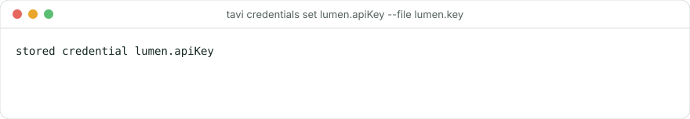
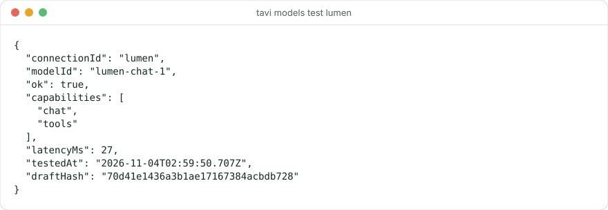
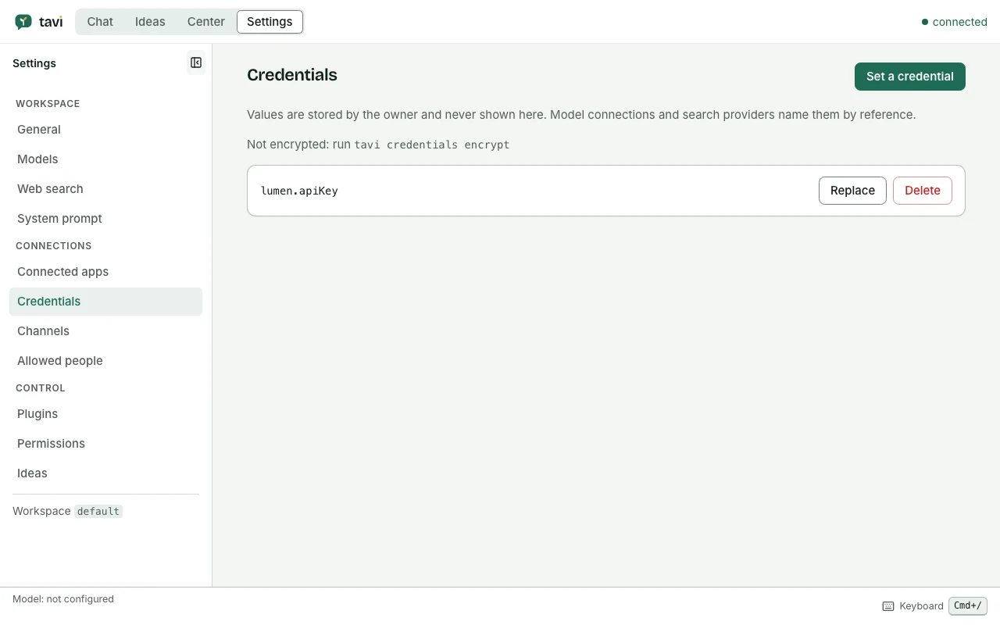
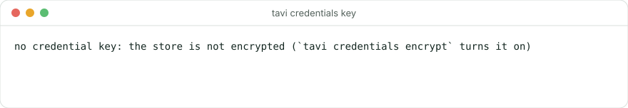
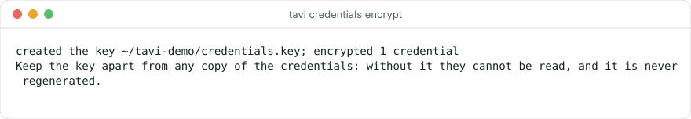

# Store and rotate API keys

Keep a provider's key in Tavi's credential store, replace it when the provider issues a new one, and check that the store is encrypted, with its key in your OS keychain. The example is a made-up provider, Lumen AI. About five minutes.

> **Uses:** the credential store (`tavi credentials list`, `key`, `encrypt`) · model connections (`tavi models test lumen`) · **Settings → Credentials**
> **Before you start:** Tavi running in the background with `tavi serve` ([Keep Tavi running in the background](../get-started/keep-tavi-running.md)) · a key from your provider, saved in a file only you can read (`chmod 600`)

## 1. Store the key

Run `tavi credentials set lumen.apiKey --file lumen.key`. Tavi reads the key from the file, which must be yours alone (`0600`) and not a link, and stores it under the name `lumen.apiKey`. It never prints the key back, so you can delete the file afterwards.

<picture>
  <source media="(prefers-color-scheme: dark)" srcset="../../assets/use-cases/run-and-maintain/credentials/01-store-the-key-dark.svg">
  
</picture>

## 2. Use it for a connection

A connection names its key by reference: `tavi models add lumen --base-url <url> --credential lumen.apiKey --model lumen-chat-1`, with the provider's address as `<url>`. Then run `tavi models test lumen`: one short request, sent with the stored key, says whether the provider takes it.

<picture>
  <source media="(prefers-color-scheme: dark)" srcset="../../assets/use-cases/run-and-maintain/credentials/02-use-it-for-a-connection-dark.svg">
  
</picture>

## 3. See what is stored

Open **Settings → Credentials**, or run `tavi credentials list`. Both list the names only: a value is never shown again, here or anywhere. Under the notice, the page says whether the store is encrypted and where its key is. **Replace** stores a new value through a masked form, and **Delete** removes one. `tavi credentials delete <name>` also names any connection that still uses the key it removed.

## 4. Rotate the key

When the provider gives you a new key, save it to a file and store it under the same name: `tavi credentials set lumen.apiKey --file lumen-new.key`. Every connection that names `lumen.apiKey` uses the new key from its next call, with no restart. Run `tavi models test lumen` again before you revoke the old key at the provider.

<picture>
  <source media="(prefers-color-scheme: dark)" srcset="../../assets/use-cases/run-and-maintain/credentials/04-rotate-the-key-dark.svg">
  
</picture>

## 5. Check where the encryption key is

Run `tavi credentials key`. A data directory made by this version of Tavi is encrypted from the start, and the command names the OS keychain item that holds its key (the macOS Keychain, or a Secret Service keyring on Linux). An older directory, or one on a computer with no keychain, says the store is not encrypted. **Settings → Credentials** says the same in one line: "Encrypted; key in the macOS Keychain", or "Not encrypted: run `tavi credentials encrypt`".

<picture>
  <source media="(prefers-color-scheme: dark)" srcset="../../assets/use-cases/run-and-maintain/credentials/05-check-where-the-encryption-key-is-dark.svg">
  
</picture>

## 6. Encrypt an older store

Run `tavi credentials encrypt`. Every stored value is encrypted (AES-256-GCM) under a new key, kept in the keychain where there is one, else in `credentials.key` beside the store. Running it again changes nothing, and your connections keep working as before.

<!-- cover -->
<picture>
  <source media="(prefers-color-scheme: dark)" srcset="../../assets/use-cases/run-and-maintain/credentials/06-encrypt-an-older-store-dark.svg">
  
</picture>

## What Tavi will and won't do

No command, page or chat ever shows a stored value, and the model can neither read nor write the store: only you add keys. Encrypted values cannot be read without their key, so a backup with `--include-credentials` never carries it. Before you move a data directory to another computer, run `tavi credentials key --to-file` to take the key out of the keychain and keep it apart from the copy ([CONFIGURATION.md](../../CONFIGURATION.md#credentials)).

## Related

- [Add a provider and pick models per role](switch-models.md)
- [Set up web search](../web-and-browser/set-up-web-search.md)
- [Connect your first model, OpenAI-compatible or Anthropic](../get-started/first-model.md)
- Reference: [CLI.md](../../CLI.md#tavi-credentials), [CONFIGURATION.md](../../CONFIGURATION.md#credentials)
