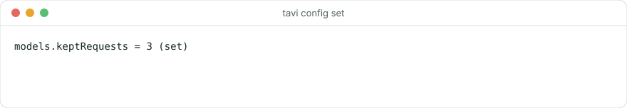
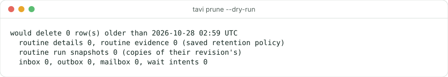
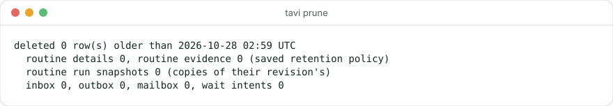
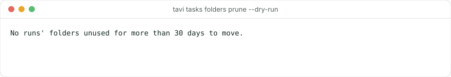
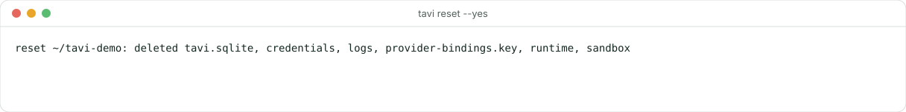

# Keep storage small, or start over

Keep fewer full model requests, delete finished delivery records and old chat folders now rather than waiting for Tavi's own sweep, and, when you want a clean slate, reset everything. About five minutes.

> **Uses:** workspace settings (`tavi config set models.keptRequests <number>`) · the retention sweep (`tavi prune`) · chats' folders (`tavi tasks folders prune`) · starting over (`tavi reset --yes`, or **Settings → General → Reset instance**)
> **Before you start:** Tavi set up and running with `tavi serve` ([Keep Tavi running in the background](../get-started/keep-tavi-running.md)) · before step 5, a backup ([Back up, export and restore your data](back-up-and-restore.md))

## 1. Keep fewer model requests

Each chat keeps the whole request of its newest 10 model calls, which helps when you're working out why Tavi answered as it did; older calls keep only their cost and usage. Run `tavi config set models.keptRequests 3` to keep fewer, or `0` to keep none once a call ends.

<picture>
  <source media="(prefers-color-scheme: dark)" srcset="../../assets/use-cases/run-and-maintain/free-up-space/01-keep-fewer-model-requests-dark.svg">
  
</picture>

## 2. See what a prune would delete

`tavi serve` deletes finished delivery records older than 30 days every six hours by itself. To go further now, stop `tavi serve` (a prune needs the data directory to itself), then run `tavi prune --older-than 7 --dry-run`: it counts what would go and deletes nothing.

<picture>
  <source media="(prefers-color-scheme: dark)" srcset="../../assets/use-cases/run-and-maintain/free-up-space/02-see-what-a-prune-would-delete-dark.svg">
  
</picture>

## 3. Prune now

Run `tavi prune --older-than 7`. It deletes the messages already handled, sends already settled and waits already over; your chats, tasks, approvals and reports are the record of what Tavi did, and stay. Add `--include-artifacts` to delete old screenshots and downloads too.

<!-- cover -->
<picture>
  <source media="(prefers-color-scheme: dark)" srcset="../../assets/use-cases/run-and-maintain/free-up-space/03-prune-now-dark.svg">
  
</picture>

## 4. Tidy the chats' folders

Each chat has a working folder. With `tavi serve` still stopped, run `tavi tasks folders prune --dry-run` to see which runs' folders haven't been used for 30 days, then without `--dry-run` to move them to the trash, which is emptied after 7 days. Your Home's and side chats' folders go only when you name one with `--chat <task-id>`.

<picture>
  <source media="(prefers-color-scheme: dark)" srcset="../../assets/use-cases/run-and-maintain/free-up-space/04-tidy-the-chats-folders-dark.svg">
  
</picture>

## 5. Start over

To go back to a fresh install, run `tavi reset --yes`, or choose **Reset instance…** at the bottom of **Settings → General** and type `reset`. Every chat, memory, schedule, setting, saved key and installed plugin is deleted, and nothing is kept, so back up first. Any file of yours in the data directory is left where it is, and named.

<picture>
  <source media="(prefers-color-scheme: dark)" srcset="../../assets/use-cases/run-and-maintain/free-up-space/05-start-over-dark.svg">
  
</picture>

## What Tavi will and won't do

A prune never deletes a message a task hasn't handled yet, a review item you haven't decided or a report's PDF. A reset deletes only what Tavi writes: folders on your computer that a chat attached are never touched. With `tavi serve` running, a reset stops it, deletes, and starts it again on the empty data directory. See [OPERATIONS.md](../../OPERATIONS.md#keeping-storage-small).

## Related

- [Back up, export and restore your data](back-up-and-restore.md)
- [Change a workspace setting](workspace-settings.md)
- Reference: [CLI.md](../../CLI.md#tavi-prune), [OPERATIONS.md](../../OPERATIONS.md#starting-over)
