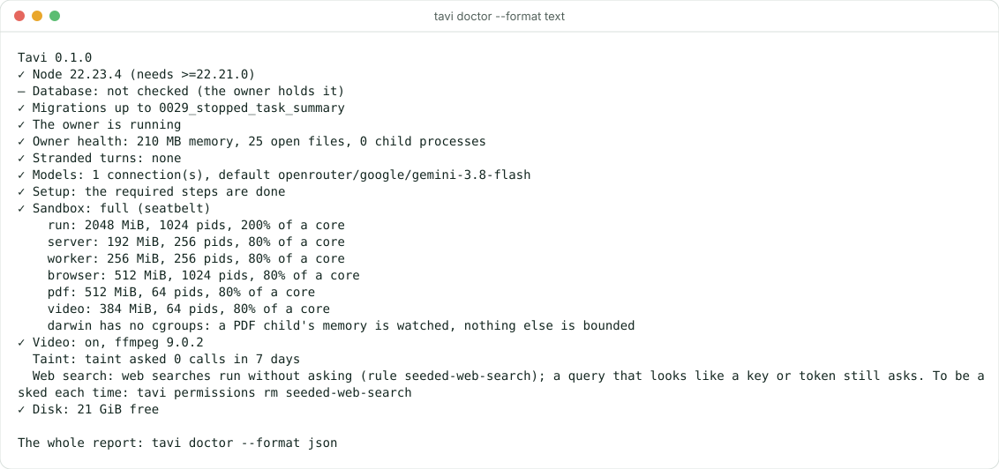
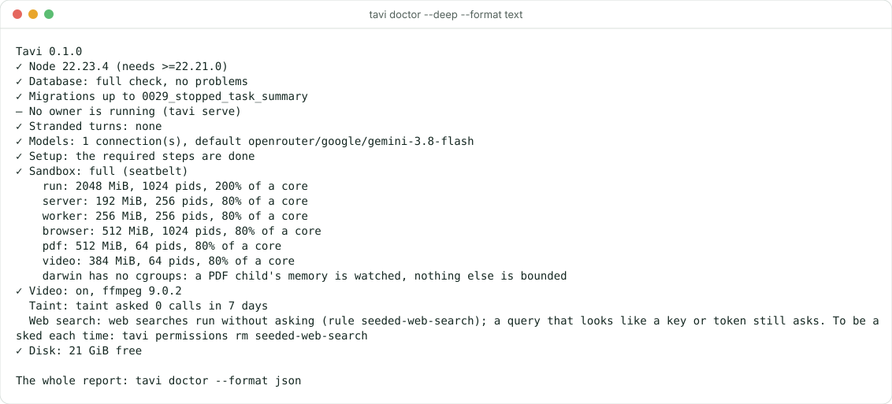
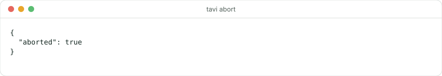
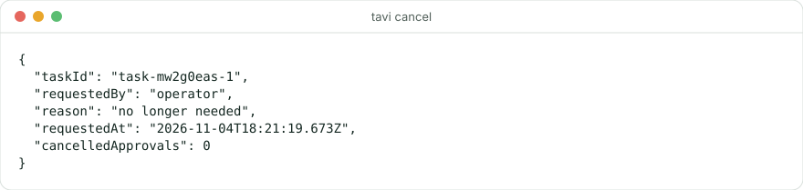
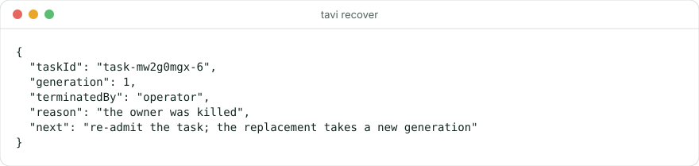
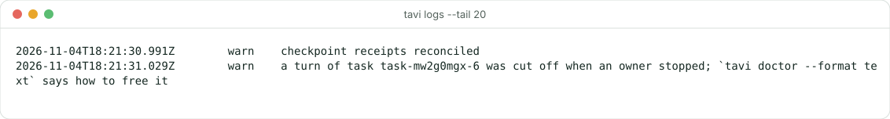

# Check Tavi's health and free a stuck task

See at a glance whether Tavi is healthy, check its database in depth, stop a turn that runs too long, and free a task a crash left behind. About ten minutes.

> **Uses:** health report (`tavi doctor`, `tavi doctor --deep`) · stopping work (`tavi abort <task-id>`, `tavi cancel <task-id> --reason <why>`) · crash recovery (`tavi recover <task-id> --generation 1 --reason <why>`) · the owner's log (`tavi logs`)
> **Before you start:** a model connected ([Connect your first model](../get-started/first-model.md)) · Tavi running in the background with `tavi serve` ([Keep Tavi running in the background](../get-started/keep-tavi-running.md))

## 1. Run the health check

Run `tavi doctor --format text`. Each line is one check, ticked when it's fine and crossed when it needs you: Node, the database, the owner, models, setup, the sandbox, video, web search and free disk space, and any turn a crash left stranded. While `tavi serve` runs, the owner answers for itself; it also watches its own memory, open files and child processes, shown on the **Owner health** line and crossed if any of them keeps growing (`tavi doctor --format json` has the samples under `health`).

<!-- cover -->
<picture>
  <source media="(prefers-color-scheme: dark)" srcset="../../assets/use-cases/run-and-maintain/health-check/01-run-the-health-check-dark.svg">
  
</picture>

## 2. Check the database in depth

The owner skips the database check so it never holds up your chats. Stop `tavi serve` (Ctrl-C), then run `tavi doctor --deep --format text`: it runs SQLite's full integrity check, which also checks every index. Without `--deep` it runs the quicker check. Start `tavi serve` again when it's done.

<picture>
  <source media="(prefers-color-scheme: dark)" srcset="../../assets/use-cases/run-and-maintain/health-check/02-check-the-database-in-depth-dark.svg">
  
</picture>

## 3. Stop a turn that runs too long

When a chat is busy with something you no longer want, run `tavi tasks` to find its id, then `tavi abort <task-id>`. The turn stops at once and the chat reads `stopped`, but it stays: you can reply to it or resume it later.

<picture>
  <source media="(prefers-color-scheme: dark)" srcset="../../assets/use-cases/run-and-maintain/health-check/03-stop-a-turn-that-runs-too-long-dark.svg">
  
</picture>

## 4. Cancel a task for good

To end a task so nothing can bring it back, run `tavi cancel <task-id> --reason "<why>"`. Cancelling is final: it closes the task's waiting approvals, and a late reply from a worker can't wake it again. It records who cancelled it: your login name, or the name you give with `--operator`. Cancel, too, a task that waits on you and that you no longer want: an abort only stops a turn that is running.

<picture>
  <source media="(prefers-color-scheme: dark)" srcset="../../assets/use-cases/run-and-maintain/health-check/04-cancel-a-task-for-good-dark.svg">
  
</picture>

## 5. Free a task a crash left behind

If `tavi serve` was killed mid-turn (a power cut, `kill -9`), that turn still holds its task. After you start Tavi again, its log says a turn was cut off, and `tavi doctor --format text` crosses **Stranded turns** and names the task with the command that frees it (`strandedAdmissions` in the JSON). Once you're sure the old process is gone, run `tavi recover <task-id> --generation 1 --reason "<why>"`, with the generation doctor names, then retry or cancel the task as its `remedy` says.

<picture>
  <source media="(prefers-color-scheme: dark)" srcset="../../assets/use-cases/run-and-maintain/health-check/05-free-a-task-a-crash-left-behind-dark.svg">
  
</picture>

## 6. Read the logs

Run `tavi logs` for the newest lines of the owner's own log, newest last, or `tavi logs --tail 20` for fewer. Each line gives the time, the level and what happened. Keys, tokens and passwords are masked before anything is written.

<picture>
  <source media="(prefers-color-scheme: dark)" srcset="../../assets/use-cases/run-and-maintain/health-check/06-read-the-logs-dark.svg">
  
</picture>

## What Tavi will and won't do

`tavi doctor` only reads: without a running owner it opens the database directly, needs no model key, and runs no plugin code. Tavi never takes back a crashed turn's task on its own, because the old process might still be running; you confirm that by running the recover command. An abort records nothing and leaves the task usable, while a cancellation is final. The details are in [OPERATIONS.md](../../OPERATIONS.md#health-tavi-doctor).

## Related

- [Keep Tavi running in the background](../get-started/keep-tavi-running.md)
- [Check the sandbox (and set it up on Linux)](sandbox-setup.md)
- [Upgrade Tavi and its shipped instructions](upgrade.md)
- Reference: [OPERATIONS.md](../../OPERATIONS.md#health-tavi-doctor), [CLI.md](../../CLI.md#tavi-doctor)
