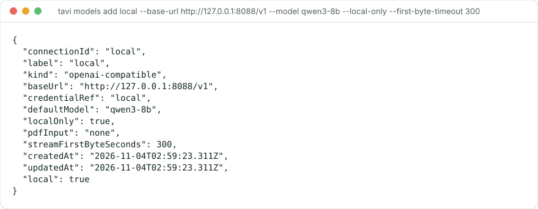
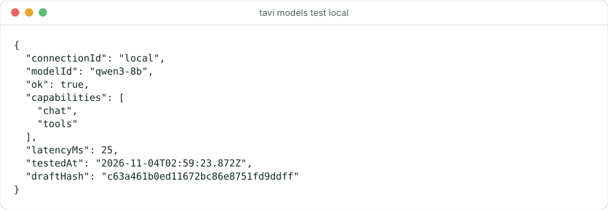
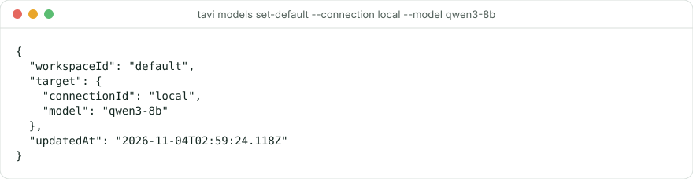
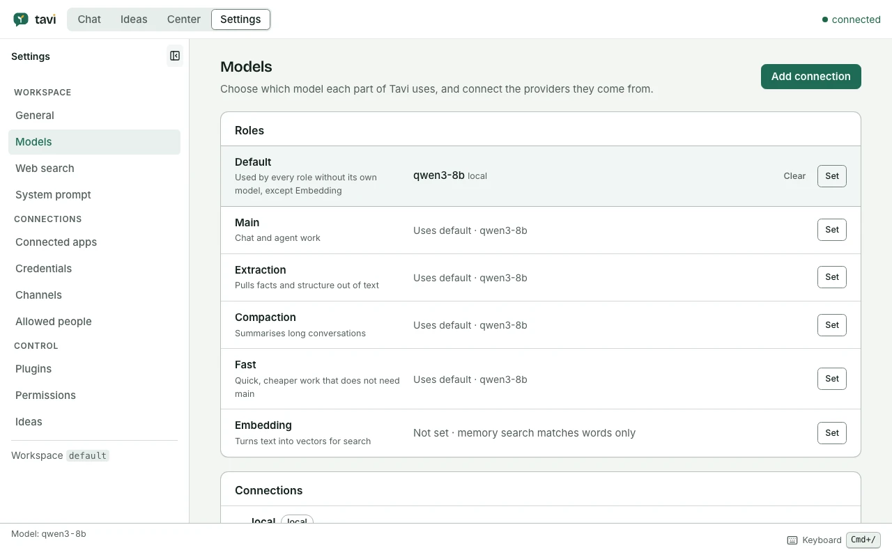

# Run on a local model

Point Tavi at a model running on your own computer, so your chats, their summaries and the notes they leave never go to a cloud provider. The example is llama.cpp's `llama-server`; Ollama and LM Studio work the same way. About ten minutes, once the model is downloaded.

> **Uses:** model connections (`tavi models list`, `test`) · roles (`tavi models roles`, `set-default`) · **Settings → Models**
> **Before you start:** Tavi running in the background with `tavi serve` ([Keep Tavi running in the background](../get-started/keep-tavi-running.md)) · a local model server with a model that can call tools, for example `llama-server -m qwen3-8b.gguf --alias qwen3-8b --port 8088 --jinja` (`--jinja` lets the model call tools)

## 1. Add the connection

Run `tavi models add local --base-url http://127.0.0.1:8088/v1 --model qwen3-8b --local-only --first-byte-timeout 300`. `llama-server` takes no key, so you name none: Tavi stores a placeholder for this connection alone, under its own name (`credentialRef: local`). An address on this computer makes the connection local (`local: true` in the answer, with or without the flag); `--local-only` records it as declared too (`localOnly: true`). With Ollama or LM Studio you can skip this step: `tavi setup model` finds a running one and connects it the same way. A large model can take a while to start answering, and `--first-byte-timeout` gives it five minutes instead of one before Tavi gives up on a call.

<picture>
  <source media="(prefers-color-scheme: dark)" srcset="../../assets/use-cases/run-and-maintain/local-models/01-add-the-connection-dark.svg">
  
</picture>

## 2. Test it

Run `tavi models test local`. Tavi sends the model one short request, on your computer, and checks that it answers and can call a tool: a model that cannot is caught here, not in your first chat.

<picture>
  <source media="(prefers-color-scheme: dark)" srcset="../../assets/use-cases/run-and-maintain/local-models/02-test-it-dark.svg">
  
</picture>

## 3. Make it the default

Run `tavi models set-default --connection local --model qwen3-8b`. From the next turn, new chats run on it, and so does every role that has no model of its own.

<picture>
  <source media="(prefers-color-scheme: dark)" srcset="../../assets/use-cases/run-and-maintain/local-models/03-make-it-the-default-dark.svg">
  
</picture>

## 4. Check that every role stays local

Open **Settings → Models**. Every role should say **Uses default** or name a local model. A role still bound to a cloud model sends its own work there (a heartbeat check on `fast`, say), so press **Reset** on it, or bind it to a local model. **Embedding** stays **Not set** unless you bind a local embedding model.

<!-- cover -->

## What Tavi will and won't do

A chat that starts on a local model stays local: its replies, summaries, titles and memory stay on local models, it falls back only to other local models, and routing never asks about it. If you later make a cloud model the default, that chat keeps its local model; only choosing a cloud model for it yourself sends its conversation out ([PRIVACY.md](../../PRIVACY.md#model-calls-and-local-connections)).

## Related

- [Add a provider and pick models per role](switch-models.md)
- [Turn on model routing](model-routing.md)
- [Connect your first model, OpenAI-compatible or Anthropic](../get-started/first-model.md)
- Reference: [PRIVACY.md](../../PRIVACY.md#model-calls-and-local-connections), [CONFIGURATION.md](../../CONFIGURATION.md#configuring-models-and-credentials)
