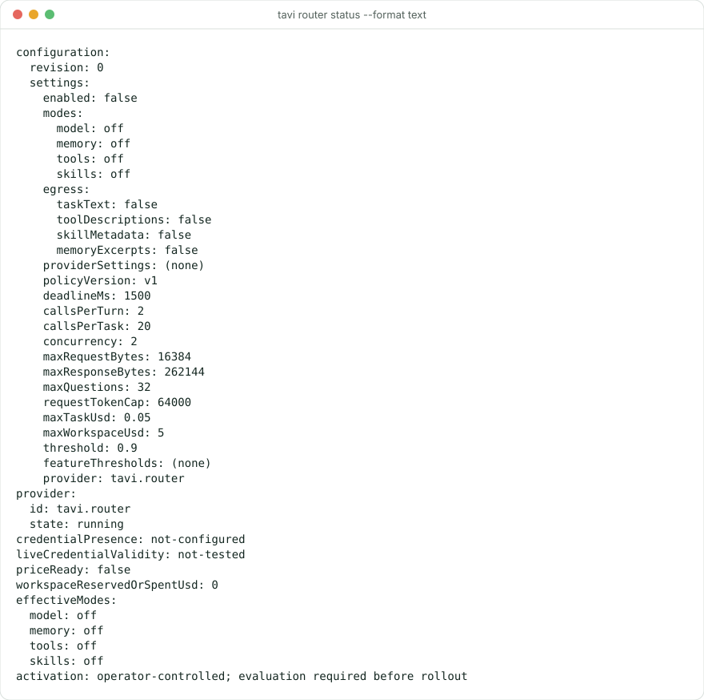
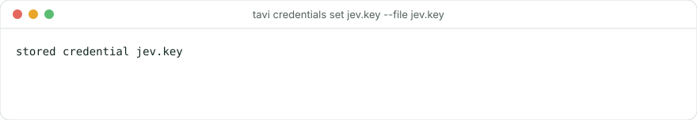
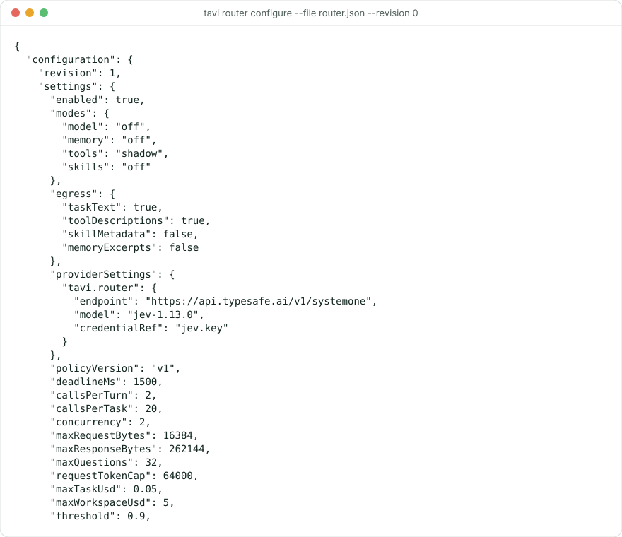
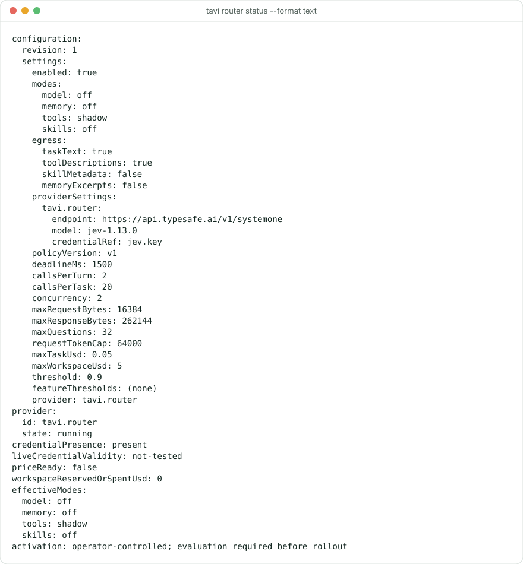
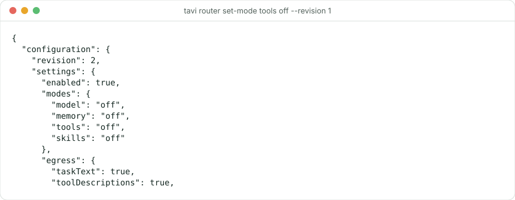

# Turn on model routing

Let a routing provider advise Tavi on which tools, memory, skills or model a chat needs, first in shadow, where its advice is only recorded, so you can measure it before it changes anything. The example is the built-in Jev provider, `tavi.router`, advising on tools. About ten minutes.

> **Uses:** routing (`tavi router status`, `configure`, `set-mode`) · the credential store (`tavi credentials list`)
> **Before you start:** Tavi running in the background with `tavi serve` ([Keep Tavi running in the background](../get-started/keep-tavi-running.md)) · a key for the routing provider, saved in a file only you can read (`chmod 600`)

## 1. See where routing stands

Run `tavi router status --format text`. On a new data directory routing is off: every feature's mode is `off`, nothing may be sent to the provider, and `revision` is `0`. Every change names the revision it starts from, so two changes never overwrite each other.

<picture>
  <source media="(prefers-color-scheme: dark)" srcset="../../assets/use-cases/run-and-maintain/model-routing/01-see-where-routing-stands-dark.svg">
  
</picture>

## 2. Store its key

Run `tavi credentials set jev.key --file jev.key`. The router's settings name the key by reference, never the key itself.

<picture>
  <source media="(prefers-color-scheme: dark)" srcset="../../assets/use-cases/run-and-maintain/model-routing/02-store-its-key-dark.svg">
  
</picture>

## 3. Turn it on, in shadow

Write the settings to `router.json`: routing on, tools in `shadow`, what may be sent (the task's text and the tools' descriptions, but no memory or skills), and the key's name.

```json
{ "settings": { "enabled": true, "modes": { "tools": "shadow" },
  "egress": { "taskText": true, "toolDescriptions": true, "skillMetadata": false, "memoryExcerpts": false },
  "providerSettings": { "tavi.router": { "credentialRef": "jev.key" } } } }
```

Then run `tavi router configure --file router.json --revision 0`. The file replaces every setting, and a setting it leaves out takes its default.

<picture>
  <source media="(prefers-color-scheme: dark)" srcset="../../assets/use-cases/run-and-maintain/model-routing/03-turn-it-on-in-shadow-dark.svg">
  
</picture>

## 4. Check what it will do

Run `tavi router status --format text` again. `effectiveModes` says what routing does now: `tools: shadow` once the provider runs and its key is present. In shadow, Tavi asks the provider about each attended chat's tools and records its advice, but the chat runs exactly as before. Until a price sheet for the provider is installed (`priceSheets` in the same file, with your agreement's rates), `priceReady` is `false` and its decisions abstain.

<!-- cover -->
<picture>
  <source media="(prefers-color-scheme: dark)" srcset="../../assets/use-cases/run-and-maintain/model-routing/04-check-what-it-will-do-dark.svg">
  
</picture>

## 5. Turn it off again

Run `tavi router set-mode tools off --revision 1`. Set it to `active` only once the advice you recorded holds up: `tavi router evaluate --file observations.json` checks your paired outcomes on this computer, with no provider call, and says whether they support it. To stop routing at once everywhere, `tavi plugins disable tavi.router` turns the provider off and keeps its settings for later.

<picture>
  <source media="(prefers-color-scheme: dark)" srcset="../../assets/use-cases/run-and-maintain/model-routing/05-turn-it-off-again-dark.svg">
  
</picture>

## What Tavi will and won't do

Routing only ever advises: a tool it picks still passes your permissions and approvals. It is never asked about a chat on a local model, nor about routines, schedules, channels or workers, and it sends only the categories you allowed. Turning a feature to `active` is your decision, after an evaluation ([ROUTER.md](../../ROUTER.md)).

## Related

- [Add a provider and pick models per role](switch-models.md)
- [Run on a local model](local-models.md)
- [Store and rotate API keys](credentials.md)
- Reference: [ROUTER.md](../../ROUTER.md), [CLI.md](../../CLI.md#tavi-router)
