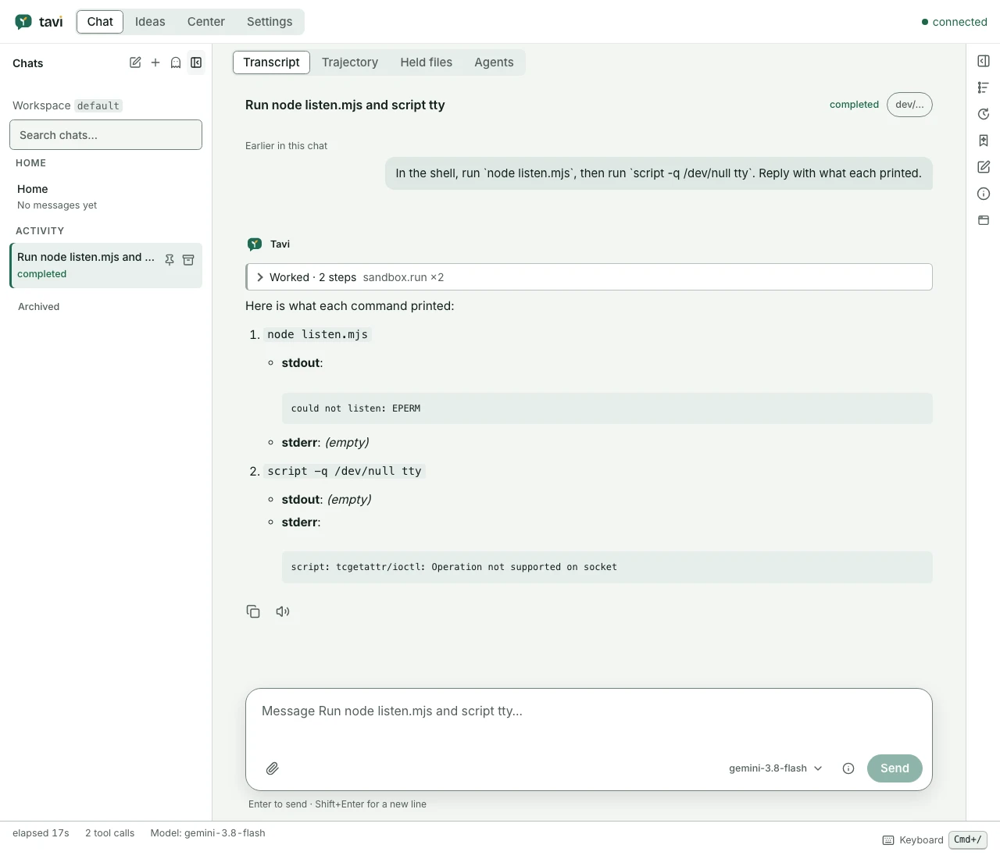
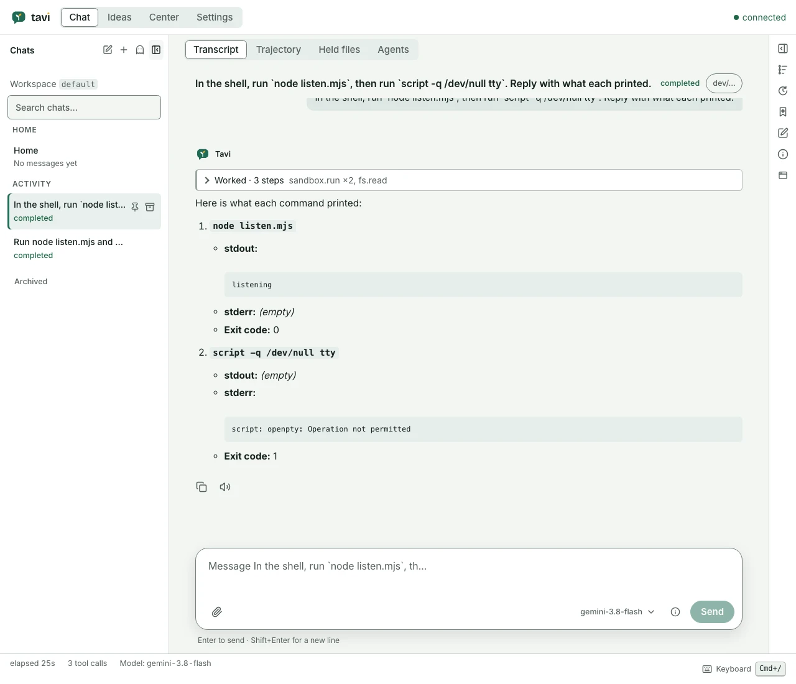
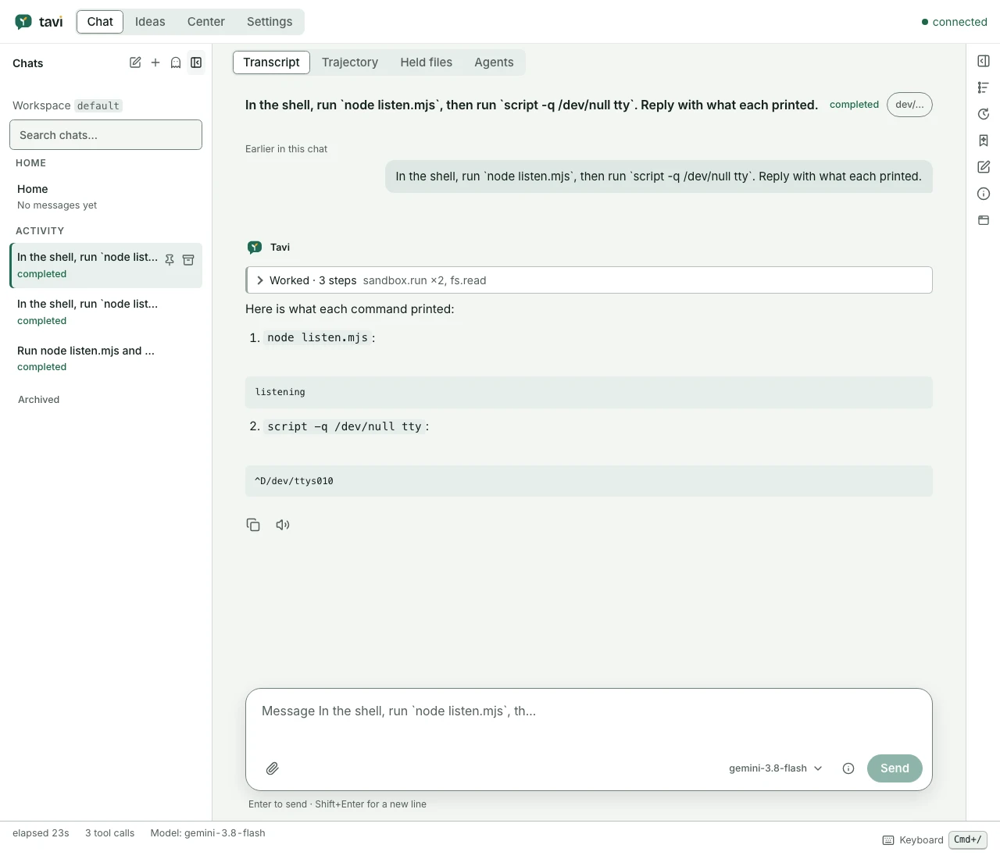
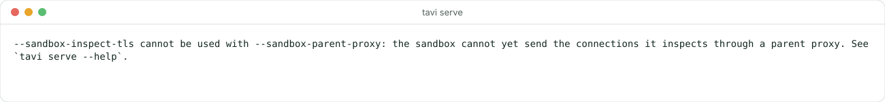

# Sandbox options for operators: terminals, local listeners, TLS inspection

Loosen or tighten what the sandbox lets a shell command do, for the work you run on this machine: let a dev server listen and a test open a terminal on macOS, or have Tavi read every HTTPS connection a command makes. About ten minutes.

> **Uses:** shell commands in the sandbox (`sandbox.run`) · the owner's sandbox options (`tavi serve --sandbox-local-bind`, `--sandbox-pty`, `--sandbox-inspect-tls`)
> **Before you start:** a model connected ([Connect your first model](../get-started/first-model.md)) · Tavi running with `tavi serve` and a project folder it may use ([Keep Tavi running in the background](../get-started/keep-tavi-running.md)) · the sandbox checked ([Check the sandbox (and set it up on Linux)](sandbox-setup.md))

## 1. See what a run can't do by default

Ask Tavi, in a chat on your project, to run a command that starts a server or needs a terminal, such as `In the shell, run node listen.mjs, then run script -q /dev/null tty.` On macOS, by default, the server can't listen (`EPERM`) and `script` can't open a pseudo-terminal, and Tavi tells you so.

## 2. Let runs listen

Stop `tavi serve` and start it again with `--sandbox-local-bind`. A run may then listen for connections, on every interface, and reach this machine's own ports; Tavi gives it `HOST=127.0.0.1`, which most dev servers read to stay on loopback. Ask again: the server listens, while `script` still can't open a terminal.

## 3. Let runs open terminals

Restart once more with `--sandbox-pty` added, for tools that need a pseudo-terminal (`script`, `expect`, node-pty tests). Ask again: now `script` prints the terminal it got. On Linux a run has its own localhost and terminals already, so neither option is needed there. To confirm what the running Tavi was started with, run `tavi doctor --format text`: the line under **Sandbox** reads `started with --sandbox-pty, --sandbox-local-bind`.

<!-- cover -->

## 4. Read every granted HTTPS connection

A command granted a domain normally reaches it through a tunnel Tavi's proxy can't read, so a grant on a shared host (a CDN) reaches everything behind it. Start `tavi serve --sandbox-inspect-tls` to have the proxy open each granted HTTPS connection with Tavi's own certificate, which only the sandboxed command is told to trust; it's never added to your system's trust store. Connections it can't read, such as `git` over SSH, are then refused, and it can't be combined with `--sandbox-parent-proxy`.

<picture>
  <source media="(prefers-color-scheme: dark)" srcset="../../assets/use-cases/run-and-maintain/sandbox-operator-options/04-read-every-granted-https-connection-dark.svg">
  
</picture>

## What Tavi will and won't do

These options belong to the owner, so only you set them when you start `tavi serve`; a chat can't turn them on. A chat holding untrusted content (a web page, an email) never gets a listener or a terminal, whatever you started Tavi with. `--sandbox-pty` also opens your own terminal windows' devices to the command, and `--sandbox-local-bind` listens on every interface (Tavi sets `HOST=127.0.0.1` so most dev servers stay on loopback), so turn them on only on a machine where that's acceptable. The details are in [SANDBOX.md](../../SANDBOX.md#local-capabilities).

## Related

- [Check the sandbox (and set it up on Linux)](sandbox-setup.md)
- [Fix a failing test](../files-and-code/fix-a-failing-test.md)
- Reference: [SANDBOX.md](../../SANDBOX.md#network), [CLI.md](../../CLI.md#tavi-serve)
