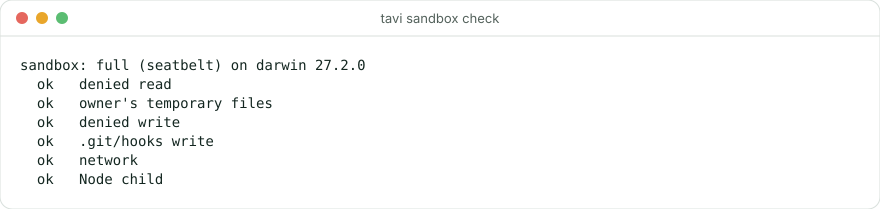
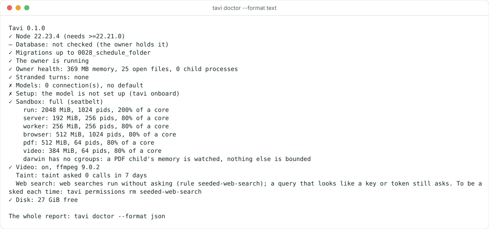
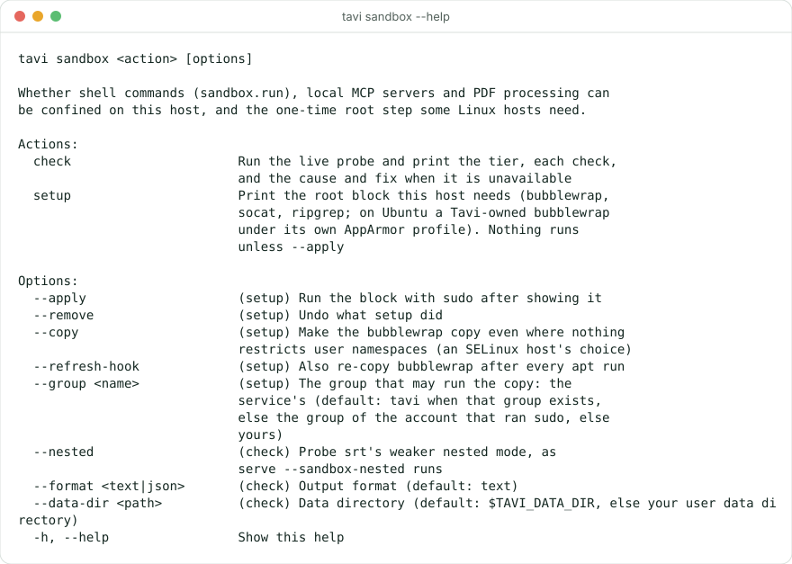
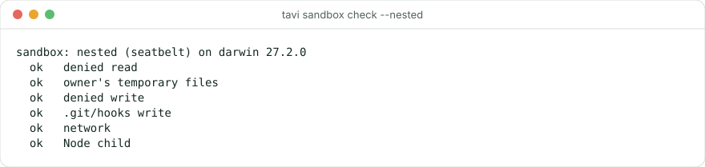

# Check the sandbox (and set it up on Linux)

Make sure the commands Tavi runs for you are confined: check the sandbox, see what it bounds, and, on Linux, run the one-time setup it asks for. About five minutes on macOS, ten on Linux.

> **Uses:** the sandbox check (`tavi sandbox check`) · the health report (`tavi doctor`) · Linux setup (`tavi sandbox setup`)
> **Before you start:** Tavi installed ([Install Tavi and put it on your PATH](../get-started/install.md)) · on Linux, an account that can use `sudo` once

## 1. Check the sandbox

Run `tavi sandbox check`. It tries what a confined command must not do (read a denied file, write outside its folder, change `.git/hooks`) and what it must still do (reach the network through Tavi's proxy, start Node), and prints the tier. `full` means every check passed; `unavailable` names the cause and the command that fixes it.

<!-- cover -->
<picture>
  <source media="(prefers-color-scheme: dark)" srcset="../../assets/use-cases/run-and-maintain/sandbox-setup/01-check-the-sandbox-dark.svg">
  
</picture>

## 2. See what it bounds

Run `tavi doctor --format text`. Its **Sandbox** line gives the same tier (or, when Tavi was started with `--sandbox-tier unavailable`, says shell commands are refused), then the memory, process and CPU limits each kind of confined child gets: a shell command (`run`), an MCP server, a plugin worker, the browser, PDF and video. macOS has no cgroups to enforce them, so the last line says what is watched there; on Linux each run gets a cgroup of its own.

<picture>
  <source media="(prefers-color-scheme: dark)" srcset="../../assets/use-cases/run-and-maintain/sandbox-setup/02-see-what-it-bounds-dark.svg">
  
</picture>

## 3. On Linux, run the one-time setup

macOS needs nothing: its sandbox is part of the system. On Linux the sandbox is bubblewrap, and `tavi sandbox setup` prints the root block your host needs: it installs `bubblewrap`, `socat` and `ripgrep`, and on Ubuntu 24.04 and later also puts a Tavi-owned copy of bubblewrap under its own AppArmor profile. Nothing runs until you add `--apply`, which shows the block again and runs it with `sudo`; `--remove` undoes it.

**On Linux** (a Debian container without bubblewrap):

```text
$ tavi sandbox check
sandbox: unavailable (bubblewrap) on linux 7.0.14-linuxkit (debian 13)
  FAIL bwrap: not installed
  FAIL socat: not installed
  FAIL rg: not installed
  ok   user namespaces
  ok   seccomp
  warn user: Tavi runs as root; tavi service unit --user <name> runs it as an ordinary user
  …
cause: bubblewrap, socat, ripgrep are not installed
fix:   tavi sandbox setup  (prints the one-time sudo block; --apply runs it), or apt install bubblewrap socat ripgrep (dnf install bubblewrap socat ripgrep)

$ tavi sandbox setup
- install bubblewrap, socat, ripgrep

The block, run as root:

set -eu
DEBIAN_FRONTEND=noninteractive apt-get install -y bubblewrap socat ripgrep

Nothing was run. Review the block, then: tavi sandbox setup --apply (it asks sudo for your password)
```

On Ubuntu the block also makes the copy, and a line above it names the group that may run it: the account `tavi serve` runs as must be in that group (`--group` names another).

Then run `tavi sandbox check` again. A running `tavi serve` picks the fix up at its next shell command, with no restart.

<picture>
  <source media="(prefers-color-scheme: dark)" srcset="../../assets/use-cases/run-and-maintain/sandbox-setup/03-on-linux-run-the-one-time-setup-dark.svg">
  
</picture>

## 4. In a container, try the nested mode

Some containers hide `/proc`, and the full sandbox can't start there. Run `tavi sandbox check --nested` to probe the sandbox's weaker nested mode, which gives up process and `/proc` isolation. If it passes and you accept that, start Tavi with `tavi serve --sandbox-nested`; every shell result then says `tier: "nested"`. Tavi never picks it on its own.

<picture>
  <source media="(prefers-color-scheme: dark)" srcset="../../assets/use-cases/run-and-maintain/sandbox-setup/04-in-a-container-try-the-nested-mode-dark.svg">
  
</picture>

## What Tavi will and won't do

There is no unconfined fallback: where the sandbox is unavailable, shell commands are refused, an MCP server that needs the network doesn't start, and the PDF and video tools are refused unless you allow them unconfined. `tavi sandbox setup` changes nothing until you add `--apply`, never changes a kernel setting, and never writes a profile for the system's own bubblewrap. The details are in [SANDBOX.md](../../SANDBOX.md#platforms-and-tiers).

## Related

- [Sandbox options for operators: terminals, local listeners, TLS inspection](sandbox-operator-options.md)
- [Check Tavi's health and free a stuck task](health-check.md)
- [Install Tavi and put it on your PATH](../get-started/install.md)
- Reference: [SANDBOX.md](../../SANDBOX.md#checking-and-setting-up-a-host), [CLI.md](../../CLI.md#tavi-sandbox)
