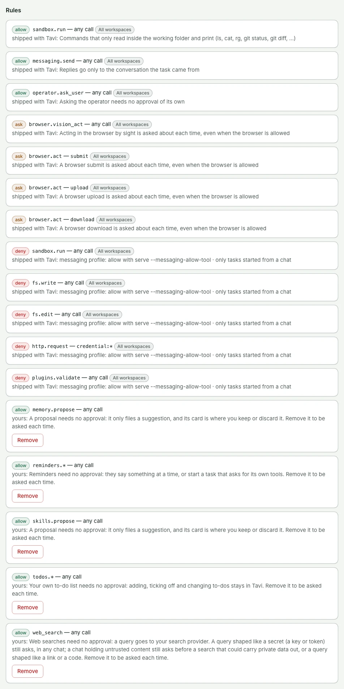
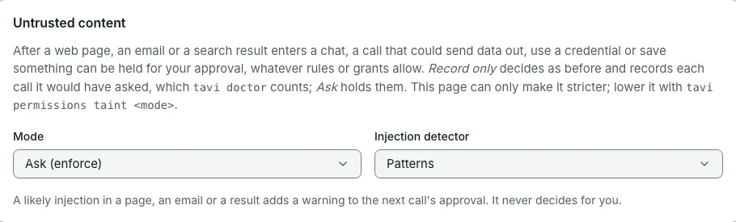
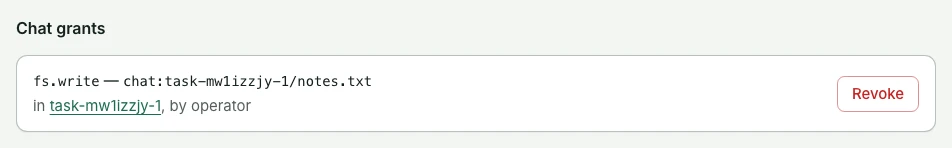
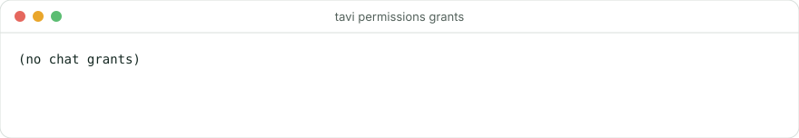
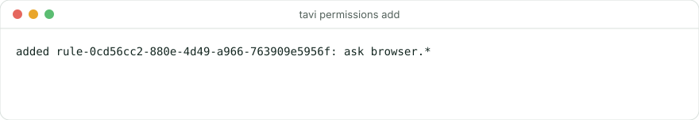
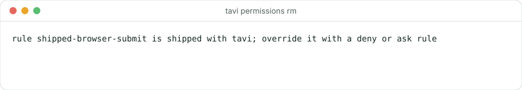

# Review what Tavi is allowed to do

See every rule that lets a tool run without asking you, take back what you allowed for a chat, and add a rule of your own. About five minutes.

> **Uses:** permission rules (`tavi permissions list`, `add`, `rm`) · chat grants (`tavi permissions grants`, `revoke`) · the untrusted-content guard (`tavi permissions taint`) · **Settings → Permissions** in the canvas
> **Before you start:** a model connected ([Connect your first model](../get-started/first-model.md)) · Tavi running in the background with `tavi serve` ([Keep Tavi running in the background](../get-started/keep-tavi-running.md)) · the canvas open ([Open the web canvas and walk through Welcome](../get-started/web-canvas-tour.md)) · approval cards met in [Approve, reject or always-allow a tool call](../chat/approve-tool-calls.md)

## 1. Open the rules

Open **Settings → Permissions** and scroll to **Rules**. Each rule says whether a tool is allowed, asked about or denied: those **shipped with Tavi** come first, then **yours**, which include a few Tavi sets up for you (reminders, your to-do list, web searches). `tavi permissions list` prints the same list.

## 2. Check the untrusted-content guard

Above the rules, **Untrusted content** is set to **Ask (enforce)**: once a web page, an email or a search result is in a chat, a call that could send data out, use a credential or save something waits for you, whatever the rules allow. Keep it there; the page can only make it stricter, and `tavi permissions taint` shows it in the terminal.

## 3. See what a chat was allowed

When you choose **Allow for this chat** on an approval card, the same call (here, writing `notes.txt`) runs unasked for the rest of that chat. Each one is listed under **Chat grants**, with the chat it belongs to.

## 4. Revoke a grant

Choose **Revoke** beside it, or run `tavi permissions revoke <grant-id>`. The chat's next call to that tool waits for your approval again. `tavi permissions grants` then shows none left.

<picture>
  <source media="(prefers-color-scheme: dark)" srcset="../../assets/use-cases/run-and-maintain/saved-permissions/04-revoke-a-grant-dark.svg">
  
</picture>

## 5. Add a rule of your own

To be asked before every browser step, run `tavi permissions add --tool 'browser.*' --decision ask --note "Ask before every browser step"`. Deny and ask rules win over allow rules, so this holds even after you allow the browser on a card. `tavi permissions rm <rule-id>` takes it away again.

<picture>
  <source media="(prefers-color-scheme: dark)" srcset="../../assets/use-cases/run-and-maintain/saved-permissions/05-add-a-rule-of-your-own-dark.svg">
  
</picture>

## 6. Override a shipped rule

A rule shipped with Tavi can't be removed, for example `tavi permissions rm shipped-browser-submit` is refused. Add a deny or ask rule of your own instead, as in step 5: it wins over the shipped one.

<picture>
  <source media="(prefers-color-scheme: dark)" srcset="../../assets/use-cases/run-and-maintain/saved-permissions/06-override-a-shipped-rule-dark.svg">
  
</picture>

## What Tavi will and won't do

The canvas never widens what runs unasked: it removes only allow rules and revokes grants, and adding a rule, or removing a deny or ask rule, is done in the terminal, as in step 5. A short built-in list of destructive commands is refused whatever the rules say, and a call marked critical is asked about even when a rule allows it. See [SECURITY-MODEL.md](../../SECURITY-MODEL.md) for the order the checks run in.

## Related

- [Approve, reject or always-allow a tool call](../chat/approve-tool-calls.md)
- [Change a workspace setting](workspace-settings.md)
- Reference: [CLI.md](../../CLI.md#tavi-permissions), [WEB-UI.md](../../WEB-UI.md#settings)
