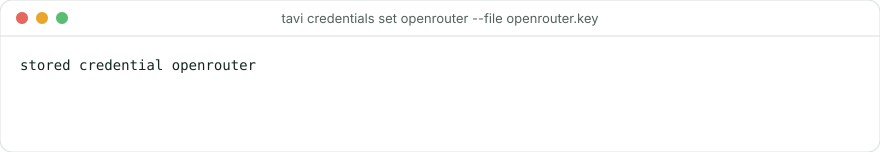
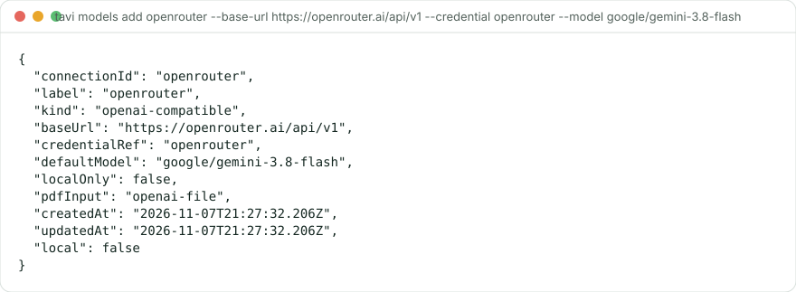
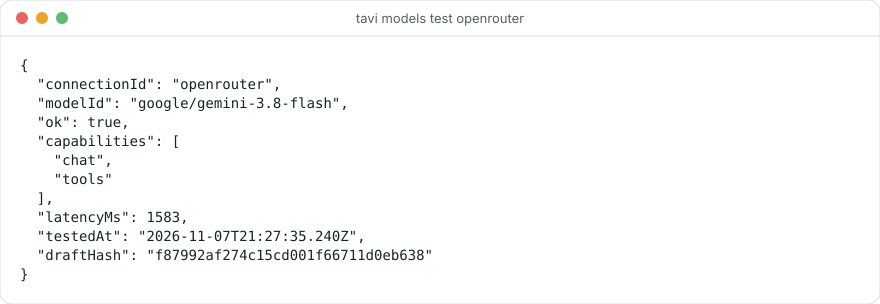
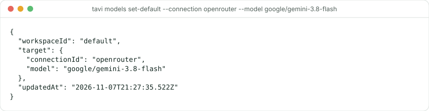
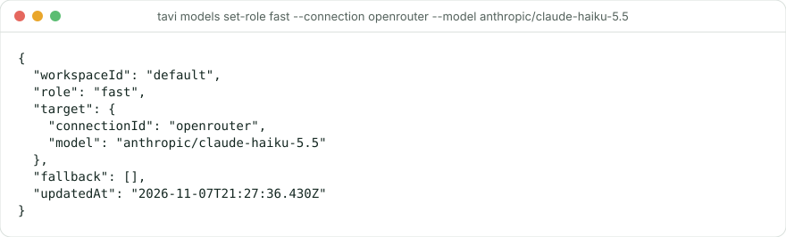
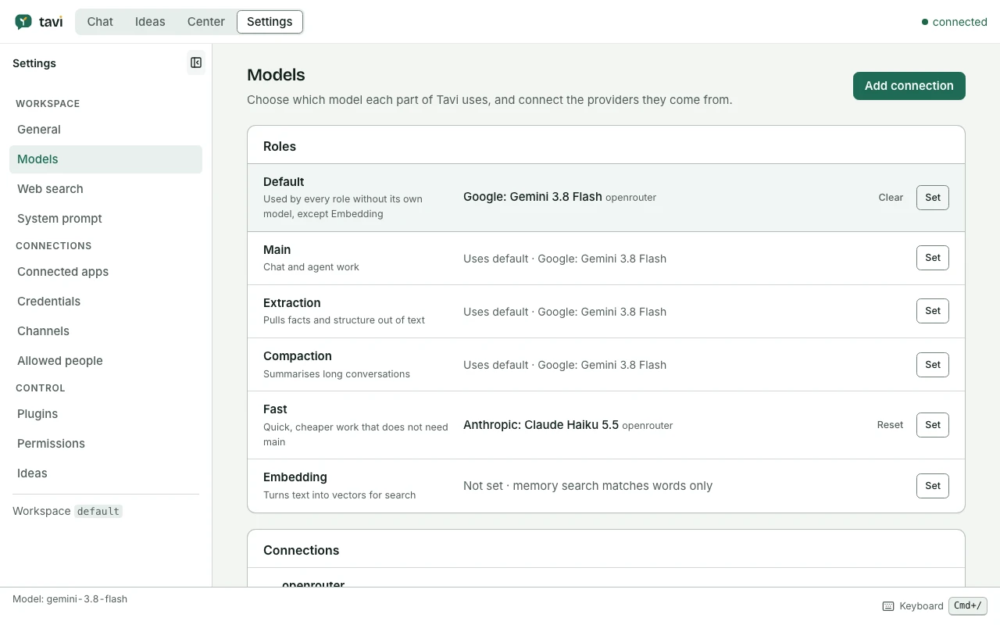
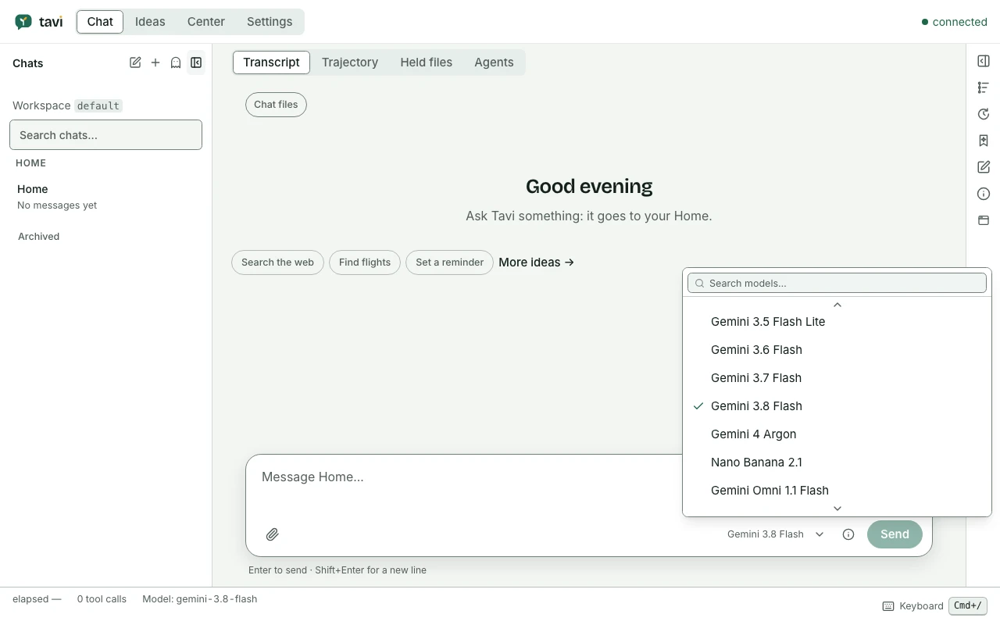

# Add a provider and pick models per role

Connect a model provider, make one of its models the default, give the quicker background jobs a cheaper model, and pick a model for a single chat. The example is OpenRouter, with Gemini Flash for chats and Claude Haiku for the fast role. About five minutes.

> **Uses:** model connections (`tavi models list`, `discover`, `test`) · roles (`tavi models roles`, `set-default`, `set-role`) · **Settings → Models** · the composer's model picker
> **Before you start:** Tavi running in the background with `tavi serve` ([Keep Tavi running in the background](../get-started/keep-tavi-running.md)) · a key from the provider, saved in a file only you can read (`chmod 600`)

## 1. Store the key

Run `tavi credentials set openrouter --file openrouter.key`. The key goes into Tavi's credential store under the name `openrouter`, and is never printed back ([Store and rotate API keys](credentials.md)).

<picture>
  <source media="(prefers-color-scheme: dark)" srcset="../../assets/use-cases/run-and-maintain/switch-models/01-store-the-key-dark.svg">
  
</picture>

## 2. Add the connection

Run `tavi models add openrouter --base-url https://openrouter.ai/api/v1 --credential openrouter --model google/gemini-3.8-flash`. Any OpenAI-compatible endpoint works the same way; for Anthropic's own API use `--base-url https://api.anthropic.com/v1`, and the connection speaks Anthropic's Messages API.

<picture>
  <source media="(prefers-color-scheme: dark)" srcset="../../assets/use-cases/run-and-maintain/switch-models/02-add-the-connection-dark.svg">
  
</picture>

## 3. List its models and test one

Run `tavi models discover openrouter` to read the models the provider offers into Tavi's catalog, then `tavi models test openrouter`. The test sends one short request to the connection's model and says whether it answered and can call tools.

<picture>
  <source media="(prefers-color-scheme: dark)" srcset="../../assets/use-cases/run-and-maintain/switch-models/03-list-its-models-and-test-one-dark.svg">
  
</picture>

## 4. Make it the default

Run `tavi models set-default --connection openrouter --model google/gemini-3.8-flash`. A model id the connection doesn't list is still saved, with a warning naming the nearest one it does. New chats use it from their next turn, with no restart; a chat already running finishes its turn on the model it began with.

<picture>
  <source media="(prefers-color-scheme: dark)" srcset="../../assets/use-cases/run-and-maintain/switch-models/04-make-it-the-default-dark.svg">
  
</picture>

## 5. Give a role its own model

The background jobs have roles of their own: `fast` for heartbeat checks and routing, `extraction` for reading pages, `compaction` for summaries, `embedding` for memory search. Run `tavi models set-role fast --connection openrouter --model anthropic/claude-haiku-5.5` to give the fast role a cheaper model. Add `--fallback <connection>/<model>` (up to three) to role `main` for a model to take over when its provider is down or rate-limited.

<picture>
  <source media="(prefers-color-scheme: dark)" srcset="../../assets/use-cases/run-and-maintain/switch-models/05-give-a-role-its-own-model-dark.svg">
  
</picture>

## 6. Check every role in the canvas

Open **Settings → Models**. The roles come first: the default, then each role with its own model or **Uses default**; **Embedding** never uses the default, and stays **Not set** until you choose one. **Set** opens a picker for a role's model and its fallbacks, with a test before it saves, and **Reset** puts a role back on the default.

<!-- cover -->

## 7. Pick a model for one chat

In a chat, Home included, open the model picker beside **Send** and choose another model; type in its search box to narrow the list. That chat runs it from its next turn, whatever the default does later, and new chats start on it too; in `tavi chat`, `/model openrouter anthropic/claude-haiku-5.5` does the same.

## What Tavi will and won't do

A connection names its key by reference, so the key never appears in a command, a log or a page. A changed default or role applies from the next turn, and a turn keeps the model it began with. A chat on a model on your own computer is never moved to a remote one by a role or a fallback ([Run on a local model](local-models.md)).

## Related

- [Store and rotate API keys](credentials.md)
- [Run on a local model](local-models.md)
- [Turn on model routing](model-routing.md)
- Reference: [CONFIGURATION.md](../../CONFIGURATION.md#configuring-models-and-credentials), [CLI.md](../../CLI.md#tavi-models)
