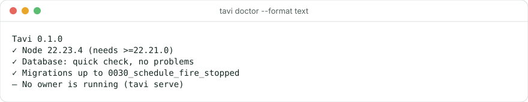
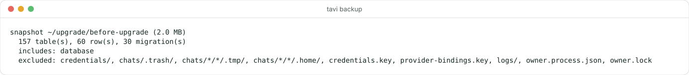
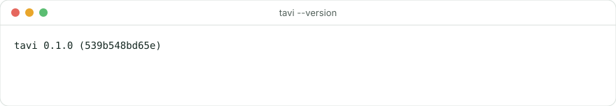
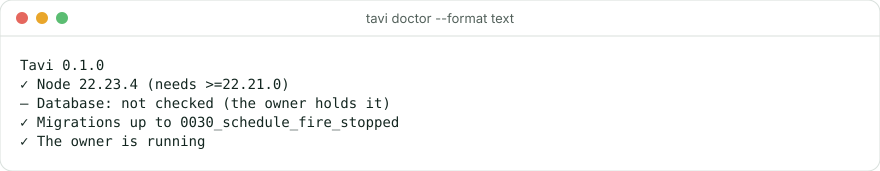
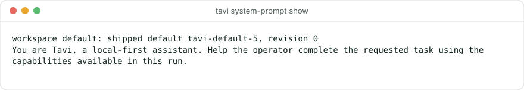
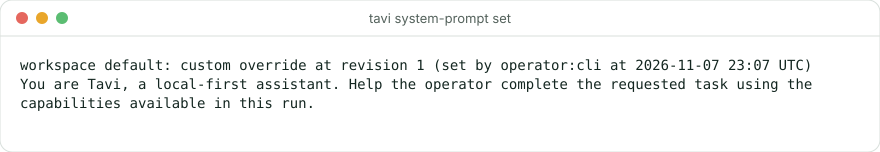
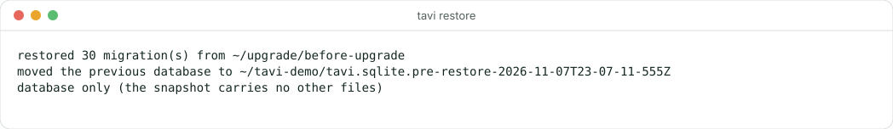

# Upgrade Tavi and its shipped instructions

Move to a new build of Tavi without losing anything: stop it, take a snapshot, install, and start it again, then decide whether your chats follow the new build's instructions. About ten minutes.

> **Uses:** snapshots (`tavi backup --out <folder>`, `tavi restore --from <folder>`) · the health report (`tavi doctor`) · the instructions every chat starts from (`tavi system-prompt show`, `set`, `reset`)
> **Before you start:** Tavi installed ([Install Tavi and put it on your PATH](../get-started/install.md)) · Tavi running in the background ([Keep Tavi running in the background](../get-started/keep-tavi-running.md))

## 1. Stop Tavi

Press Ctrl-C where `tavi serve` runs, or stop its service: `launchctl bootout gui/$(id -u)/dev.tavi.serve` on macOS, `systemctl --user stop dev.tavi.serve` on Linux. Killing the process isn't enough, because the service starts it again. Let it finish its running turns, then check with `tavi doctor --format text`: it says no owner is running.

<picture>
  <source media="(prefers-color-scheme: dark)" srcset="../../assets/use-cases/run-and-maintain/upgrade/01-stop-tavi-dark.svg">
  
</picture>

## 2. Take a snapshot

Run `tavi backup --out <folder>`, with a new folder outside Tavi's data directory. A build that brings new database changes makes your data unreadable to older builds, so this snapshot is how you go back. Keys aren't in it: they stay where they are.

<picture>
  <source media="(prefers-color-scheme: dark)" srcset="../../assets/use-cases/run-and-maintain/upgrade/02-take-a-snapshot-dark.svg">
  
</picture>

## 3. Install the new build

In your copy of Tavi, run `git pull`, then `pnpm install` and `pnpm run build`. Then `tavi --version` prints the new version and the commit it was built from.

<picture>
  <source media="(prefers-color-scheme: dark)" srcset="../../assets/use-cases/run-and-maintain/upgrade/03-install-the-new-build-dark.svg">
  
</picture>

## 4. Start Tavi again

Start `tavi serve` again (or its service). It applies the new build's database changes as it opens your data, and `tavi doctor --format text` lists them on its **Migrations** line. Then restart `tavi ui`, reload its open tabs, and restart any `tavi chat`: a client from the old build stops at the first event with "restart the service" or a closed connection, and the message it sent may already have run, so check it before you send it again.

<picture>
  <source media="(prefers-color-scheme: dark)" srcset="../../assets/use-cases/run-and-maintain/upgrade/04-start-tavi-again-dark.svg">
  
</picture>

## 5. See which instructions your chats use

Every chat starts from instructions Tavi ships, and a new build may ship newer ones. Run `tavi system-prompt show`: its first line names the shipped version your new chats get, such as `tavi-default-5`. A chat already under way keeps the version it started with; only new chats move to the new one.

<picture>
  <source media="(prefers-color-scheme: dark)" srcset="../../assets/use-cases/run-and-maintain/upgrade/05-see-which-instructions-your-chats-use-dark.svg">
  
</picture>

## 6. Or keep your own across upgrades

To keep the instructions you have, whatever a later build ships, save them in a file and run `tavi system-prompt set --file <file>`. Your own text always outranks the shipped one, and every chat takes it from its next message. `tavi system-prompt reset` goes back to the shipped instructions.

<picture>
  <source media="(prefers-color-scheme: dark)" srcset="../../assets/use-cases/run-and-maintain/upgrade/06-or-keep-your-own-across-upgrades-dark.svg">
  
</picture>

## 7. Roll back with your snapshot

If the new build doesn't suit you, stop Tavi, go back to the older build (`git checkout <commit>`, then `pnpm install` and `pnpm run build`), and run `tavi restore --from <folder>` with the snapshot from step 2. The database you had is moved aside, not deleted, and anything written since the snapshot is set aside with it.

<!-- cover -->
<picture>
  <source media="(prefers-color-scheme: dark)" srcset="../../assets/use-cases/run-and-maintain/upgrade/07-roll-back-with-your-snapshot-dark.svg">
  
</picture>

## What Tavi will and won't do

An older build refuses to open data a newer one has changed, naming the database changes it doesn't know, rather than guessing; going back is always a restore. A restore checks the snapshot before moving anything, and keeps the database it replaces. Your keys aren't in a snapshot and stay untouched. The details are in [CLI.md](../../CLI.md#upgrades) and [OPERATIONS.md](../../OPERATIONS.md#upgrading).

## Related

- [Back up, export and restore your data](back-up-and-restore.md)
- [Check Tavi's health and free a stuck task](health-check.md)
- [Keep Tavi running in the background](../get-started/keep-tavi-running.md)
- Reference: [CLI.md](../../CLI.md#upgrading-the-shipped-system-prompt), [OPERATIONS.md](../../OPERATIONS.md#upgrading)
