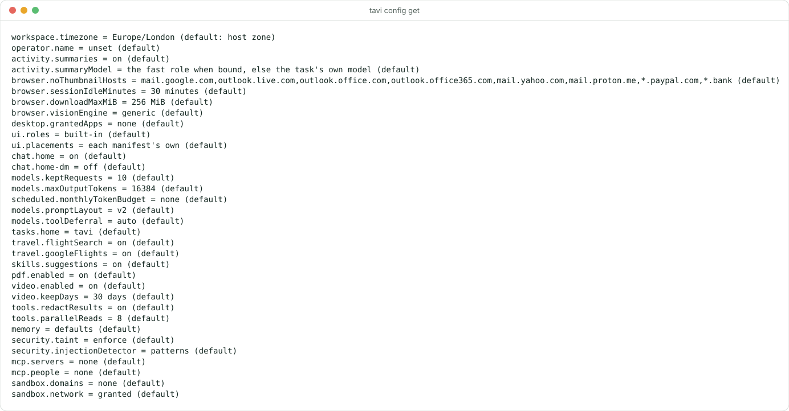
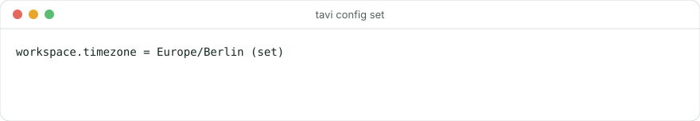
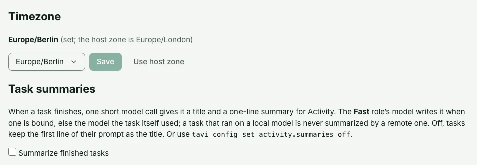
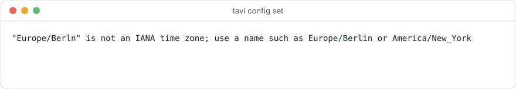
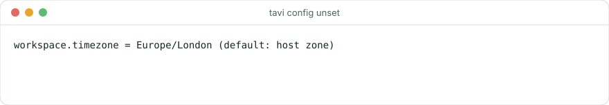

# Change a workspace setting

See every setting your workspace has, change one from the terminal or the web canvas, and put it back to its default. About three minutes.

> **Uses:** workspace settings (`tavi config get`, `tavi config set workspace.timezone Europe/Berlin`, `tavi config unset workspace.timezone`) · **Settings → General** in the canvas
> **Before you start:** Tavi running in the background with `tavi serve` ([Keep Tavi running in the background](../get-started/keep-tavi-running.md)) · for step 3, the canvas open ([Open the web canvas and walk through Welcome](../get-started/web-canvas-tour.md))

## 1. See every setting

Run `tavi config get`. Each line is one setting and its value, marked `(default)` while you haven't changed it. Add a key, such as `tavi config get workspace.timezone`, to see only that one.

<picture>
  <source media="(prefers-color-scheme: dark)" srcset="../../assets/use-cases/run-and-maintain/workspace-settings/01-see-every-setting-dark.svg">
  
</picture>

## 2. Change one in the terminal

Run `tavi config set workspace.timezone Europe/Berlin`. The change reaches Tavi's next model call, even in a chat that's already running, so "tomorrow at 9" now means 9 in Berlin.

<picture>
  <source media="(prefers-color-scheme: dark)" srcset="../../assets/use-cases/run-and-maintain/workspace-settings/02-change-one-in-the-terminal-dark.svg">
  
</picture>

## 3. Change one on the canvas

Open **Settings → General**. The time zone you just set is shown under **Timezone**. Untick **Summarize finished tasks** under **Task summaries**: it's saved as you click, and finished chats keep the first line of their prompt as their title instead of a generated one.

## 4. Mistype a value

Tavi checks every value before saving it. A time zone it doesn't know, such as `tavi config set workspace.timezone Europe/Berln`, is refused with the value named, and the setting stays as it was. A mistyped key, such as `workspace.timezon`, is answered in one line with the key you most likely meant.

<picture>
  <source media="(prefers-color-scheme: dark)" srcset="../../assets/use-cases/run-and-maintain/workspace-settings/04-mistype-a-value-dark.svg">
  
</picture>

## 5. Put a setting back

Run `tavi config unset workspace.timezone`. The setting goes back to its default, here the time zone of the computer `tavi serve` runs on.

<picture>
  <source media="(prefers-color-scheme: dark)" srcset="../../assets/use-cases/run-and-maintain/workspace-settings/05-put-a-setting-back-dark.svg">
  
</picture>

## What Tavi will and won't do

A setting belongs to one workspace (`--workspace <id>` picks another), and a value Tavi can't use is refused rather than stored. Two people changing the same setting at once can't overwrite each other: the second write is refused as a conflict, and you try again. The canvas can only make **Settings → Permissions** stricter, never looser; see [Review what Tavi is allowed to do](saved-permissions.md).

## Related

- [Review what Tavi is allowed to do](saved-permissions.md)
- [Keep storage small, or start over](free-up-space.md)
- [Cap what a schedule or routine may spend](../automation/cap-what-it-spends.md)
- Reference: [CONFIGURATION.md](../../CONFIGURATION.md#workspace-settings), [CLI.md](../../CLI.md#tavi-config), [WEB-UI.md](../../WEB-UI.md#settings)
