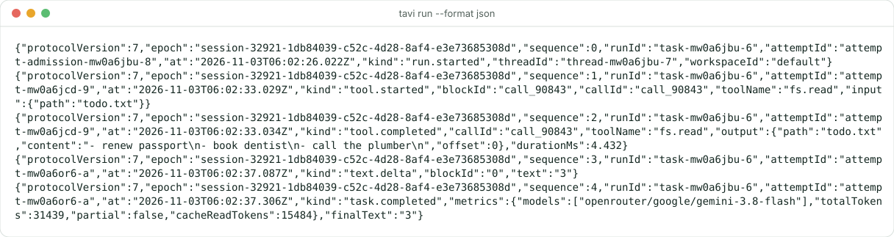
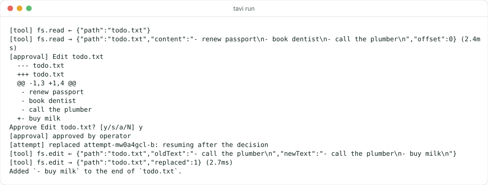
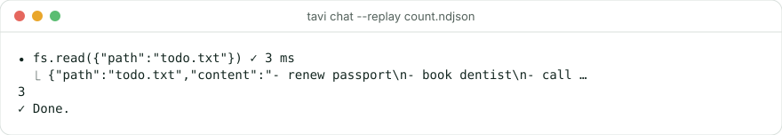
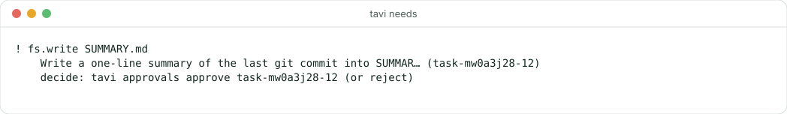

<!-- Generated by scripts/docs/guide-indexes.mjs from the guides: edit the guides, not this file. -->

# Scripting

One-shot tasks, shell pipelines and unattended runs.

| | Guide |
| :--- | :--- |
|  | [Use Tavi in a shell pipeline (`--format json`)](json-pipelines.md) Feed Tavi's answer to another command, read every step of a run as JSON lines, and make a script safe to retry. |
|  | [Run a one-shot task from your shell](one-shot-task.md) Ask Tavi one thing from your shell and get the answer back without opening a chat: a quick question, a job in a folder, an approval when it needs one. |
|  | [Replay a saved run in the terminal UI](replay-a-run.md) Save a run's events to a file and play them back in the terminal chat, to see what a script's run did, or to share it with someone, without an owner or a model. |
|  | [Run Tavi from a git hook or cron without prompts](unattended-runs.md) Run Tavi where nobody is at the keyboard, from a git hook or a cron job, and decide up front what it may do, so it never sits waiting on a question. |

[All how-to guides](../README.md)
