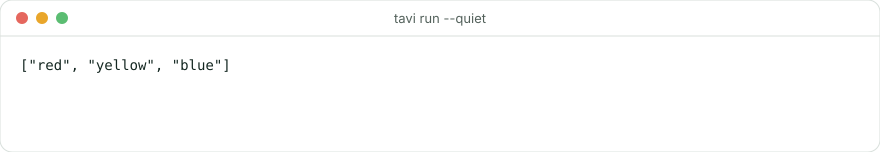
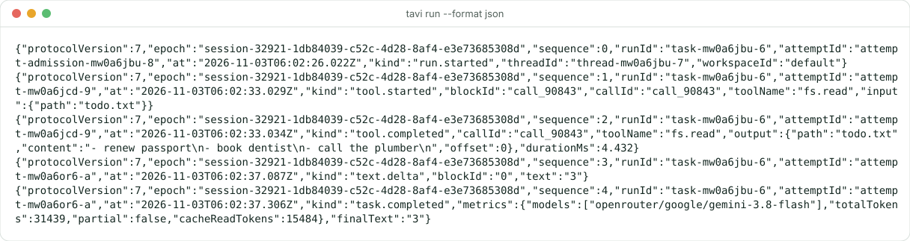
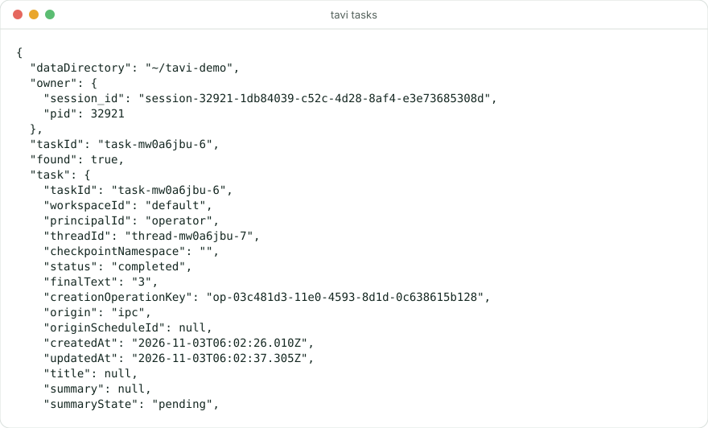
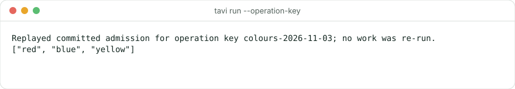

# Use Tavi in a shell pipeline (`--format json`)

Feed Tavi's answer to another command, read every step of a run as JSON lines, and make a script safe to retry. About five minutes.

> **Uses:** one-shot runs (`tavi run <prompt>`) · the event stream (`--format json`) · retry keys (`--operation-key`) · `jq`, or any JSON tool
> **Before you start:** a model connected ([Connect your first model](../get-started/first-model.md)) · Tavi running in the background with `tavi serve` ([Keep Tavi running in the background](../get-started/keep-tavi-running.md)) · a first run done ([Run a one-shot task from your shell](one-shot-task.md))

## 1. Pipe the answer on

Ask for an answer another command can read, and add `--quiet`: `tavi run --quiet "Name three primary colours as a JSON array of strings, nothing else."` The answer is all that goes to standard output, so `| jq length` reads it as it is.

<picture>
  <source media="(prefers-color-scheme: dark)" srcset="../../assets/use-cases/scripting/json-pipelines/01-pipe-the-answer-on-dark.svg">
  
</picture>

## 2. Stream the run as JSON lines

When a task uses tools, plain output also shows each tool call. Add `--format json` and every step arrives as one JSON line instead (`run.started`, `tool.started`, `text.delta`, …), ending with `task.completed` and the answer in its `finalText`: `tavi run --format json --folder ~/code/notes "How many items are in todo.txt? Answer with the number only."`

<!-- cover -->
<picture>
  <source media="(prefers-color-scheme: dark)" srcset="../../assets/use-cases/scripting/json-pipelines/02-stream-the-run-as-json-lines-dark.svg">
  
</picture>

## 3. Pick out what you need

Filter the lines with `jq`: pipe the run into `jq -r 'select(.kind == "task.completed") | .finalText'` for the answer, or `jq -r 'select(.kind == "tool.started") | .toolName'` for the tools it used. Every line carries the run's id (`runId`), and `tavi tasks <task-id>` prints its record as JSON any time later. The exit code tells a script how it ended: `0` done, `1` failed, `3` waiting for an approval.

<picture>
  <source media="(prefers-color-scheme: dark)" srcset="../../assets/use-cases/scripting/json-pipelines/03-pick-out-what-you-need-dark.svg">
  
</picture>

## 4. Make a retry safe

Give the run a key of your own, such as the job's name and date: `tavi run --operation-key colours-2026-11-03 "Name three primary colours as a JSON array of strings, nothing else."`. Run it again with the same key, after a timeout or a crash, and Tavi answers with the run it already did, saying no work was re-run, instead of starting another.

<picture>
  <source media="(prefers-color-scheme: dark)" srcset="../../assets/use-cases/scripting/json-pipelines/04-make-a-retry-safe-dark.svg">
  
</picture>

## What Tavi will and won't do

A run under `tavi serve` uses the owner's model and tool rules, and asks before anything that changes something: without a terminal to ask at, it stops with exit `3` rather than waiting forever, and leaves the call for you. Every event's fields are listed in [CLI.md](../../CLI.md#output-formats--event-streaming); new kinds may be added, so a script should skip kinds it doesn't know.

## Related

- [Run a one-shot task from your shell](one-shot-task.md)
- [Run Tavi from a git hook or cron without prompts](unattended-runs.md)
- [Replay a saved run in the terminal UI](replay-a-run.md)
- Reference: [CLI.md](../../CLI.md#tavi-run), [AUTOMATION.md](../../AUTOMATION.md#tavi-run-one-task-per-command)
