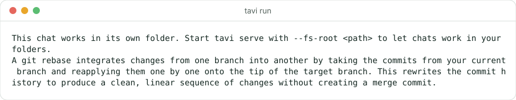
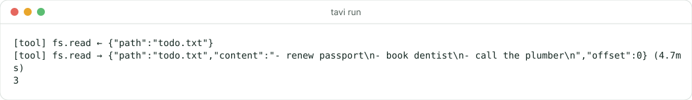
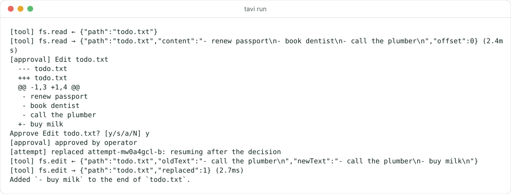
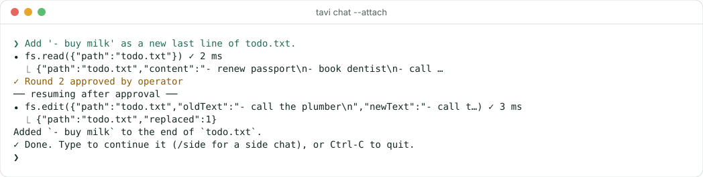

# Run a one-shot task from your shell

Ask Tavi one thing from your shell and get the answer back without opening a chat: a quick question, a job in a folder, an approval when it needs one. About five minutes.

> **Uses:** one-shot runs (`tavi run <prompt>`) · a working folder (`--folder`) · approvals at the terminal (`[y/s/a/N]`) · the terminal chat (`tavi chat --attach <task-id>`)
> **Before you start:** a model connected ([Connect your first model](../get-started/first-model.md)) · Tavi running in the background with `tavi serve` ([Keep Tavi running in the background](../get-started/keep-tavi-running.md)) · for steps 2 and 3, your projects folder named with `--fs-root` ([Give Tavi a working folder](../files-and-code/attach-a-folder.md))

## 1. Ask one thing

Run `tavi run "In two sentences, what is a git rebase?"`. The answer prints and the command exits, back at your shell prompt. Each run is a chat of its own; it never joins Home.

<picture>
  <source media="(prefers-color-scheme: dark)" srcset="../../assets/use-cases/scripting/one-shot-task/01-ask-one-thing-dark.svg">
  
</picture>

## 2. Point it at a folder

Add `--folder` to let it read your files: `tavi run --folder ~/code/notes "How many items are in todo.txt? Answer with the number only."` Reading needs no approval, and each tool call prints as it happens, before the answer.

<picture>
  <source media="(prefers-color-scheme: dark)" srcset="../../assets/use-cases/scripting/one-shot-task/02-point-it-at-a-folder-dark.svg">
  
</picture>

## 3. Approve a change

Ask for a change: `tavi run --folder ~/code/notes "Add '- buy milk' as a new last line of todo.txt."` Before it edits the file, Tavi shows the change and asks `[y/s/a/N]`: type `y` and Enter to allow it once (`s` for the rest of this chat, `a` always, `N` to deny).

<!-- cover -->
<picture>
  <source media="(prefers-color-scheme: dark)" srcset="../../assets/use-cases/scripting/one-shot-task/03-approve-a-change-dark.svg">
  
</picture>

## 4. Pick the run up in a chat

Every run is kept. Find its id with `tavi tasks`, then `tavi chat --attach <task-id>` opens it in the terminal chat with everything it did, and whatever you type next continues it.

<picture>
  <source media="(prefers-color-scheme: dark)" srcset="../../assets/use-cases/scripting/one-shot-task/04-pick-the-run-up-in-a-chat-dark.svg">
  
</picture>

## What Tavi will and won't do

A run under `tavi serve` uses the owner's model and tool rules. Anything that changes something waits for your `y`; press Ctrl-C at the question to leave it waiting for the canvas or `tavi approvals approve <task-id>` instead, while the run goes on under the owner. Without a terminal it never waits: see [Run Tavi from a git hook or cron without prompts](unattended-runs.md). The flags are in [CLI.md](../../CLI.md#tavi-run).

## Related

- [Use Tavi in a shell pipeline (`--format json`)](json-pipelines.md)
- [Approve, reject or always-allow a tool call](../chat/approve-tool-calls.md)
- [Have your first conversation in the terminal](../get-started/first-chat.md)
- Reference: [CLI.md](../../CLI.md#tavi-run), [AUTOMATION.md](../../AUTOMATION.md#tavi-run-one-task-per-command)
