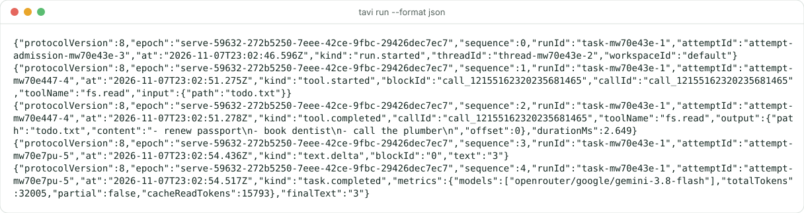
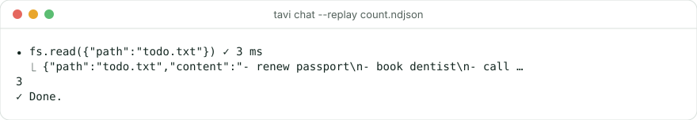
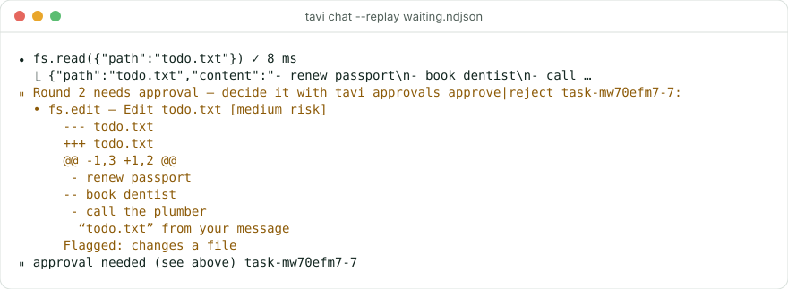
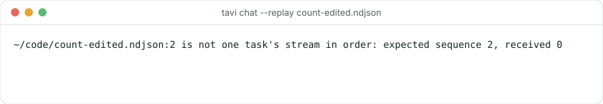

# Replay a saved run in the terminal UI

Save a run's events to a file and play them back in the terminal chat, to see what a script's run did, or to share it with someone, without an owner or a model. About five minutes.

> **Uses:** the event stream (`tavi run --format json <prompt>`) · following a run (`tavi run --attach <task-id>`) · replay in the terminal chat (`tavi chat --replay <file>`)
> **Before you start:** a model connected ([Connect your first model](../get-started/first-model.md)) · Tavi running in the background with `tavi serve` ([Keep Tavi running in the background](../get-started/keep-tavi-running.md)) · the JSON stream met in [Use Tavi in a shell pipeline](json-pipelines.md)

## 1. Save a run to a file

Run the task with `--format json` and send its output to a file: `tavi run --format json --folder ~/code/notes "How many items are in todo.txt? Answer with the number only."`, followed by `> count.ndjson`. Each line is one event of the run.

<picture>
  <source media="(prefers-color-scheme: dark)" srcset="../../assets/use-cases/scripting/replay-a-run/01-save-a-run-to-a-file-dark.svg">
  
</picture>

## 2. Play it back

Run `tavi chat --replay count.ndjson`. The terminal chat draws the run as it looked live, with its tool calls, their results and the answer, then exits. It needs no owner and calls no model, so it works on any machine with Tavi.

<!-- cover -->
<picture>
  <source media="(prefers-color-scheme: dark)" srcset="../../assets/use-cases/scripting/replay-a-run/02-play-it-back-dark.svg">
  
</picture>

## 3. Save a run you didn't record

A run started without `--format json`, such as one a script left waiting, can still be saved while `tavi serve` holds it: `tavi run --attach <task-id> --format json`, sent to a file the same way. Its replay shows where it stopped: here the edit it is waiting to make, with the diff and the command that decides it.

<picture>
  <source media="(prefers-color-scheme: dark)" srcset="../../assets/use-cases/scripting/replay-a-run/03-save-a-run-you-didn-t-record-dark.svg">
  
</picture>

## 4. Spot a damaged file

A replay checks the whole file before it draws anything. A file that isn't one run's events in order, say two runs pasted together or lines moved, is refused with exit `2`, naming the file and the first line that is wrong.

<picture>
  <source media="(prefers-color-scheme: dark)" srcset="../../assets/use-cases/scripting/replay-a-run/04-spot-a-damaged-file-dark.svg">
  
</picture>

## What Tavi will and won't do

A replay only draws: it runs no tool, calls no model and decides nothing, and a waiting round in it is answered on the live task with `tavi approvals approve <task-id>`, not in the replay. The file holds what the run saw, including file contents and tool results, so read it before you share it. The event format is in [CLI.md](../../CLI.md#output-formats--event-streaming).

## Related

- [Use Tavi in a shell pipeline (`--format json`)](json-pipelines.md)
- [Run Tavi from a git hook or cron without prompts](unattended-runs.md)
- [Find and answer everything Tavi is waiting on](../chat/answer-waiting-questions.md)
- Reference: [TERMINAL-UI.md](../../TERMINAL-UI.md), [CLI.md](../../CLI.md#tavi-chat)
