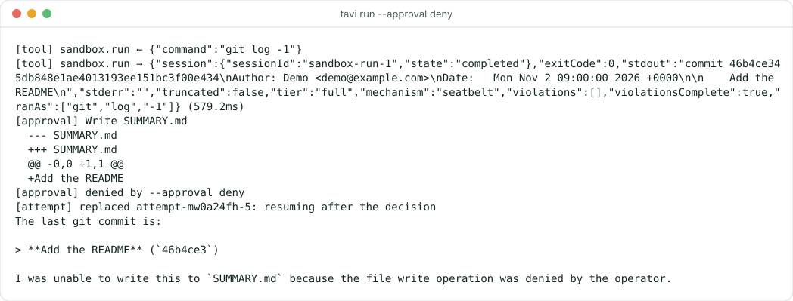
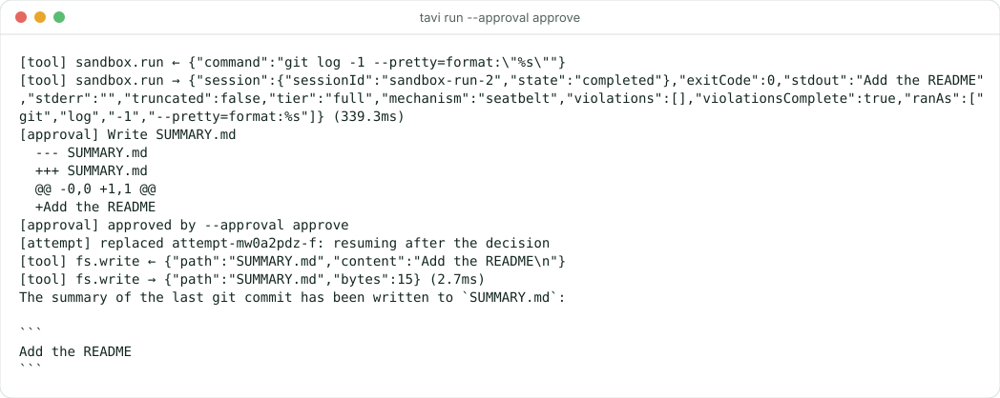
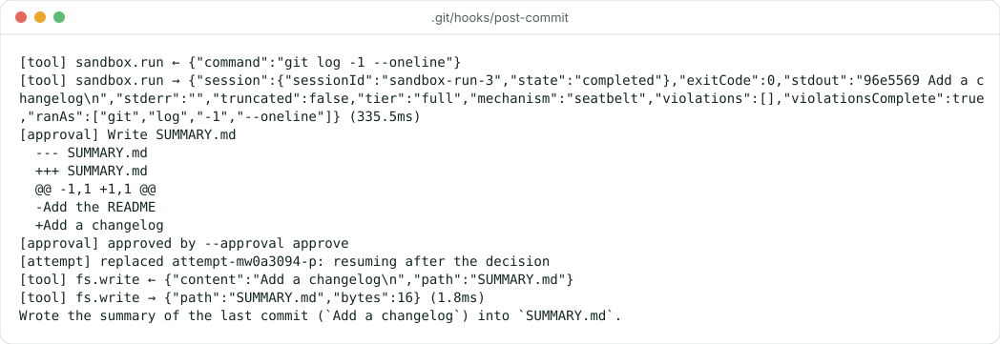
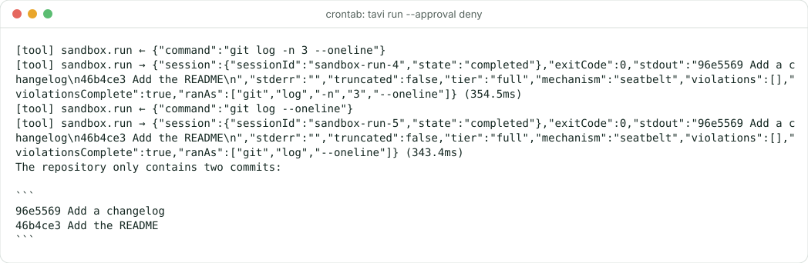
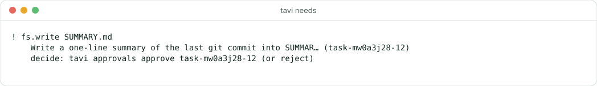

# Run Tavi from a git hook or cron without prompts

Run Tavi where nobody is at the keyboard, from a git hook or a cron job, and decide up front what it may do, so it never sits waiting on a question. About ten minutes.

> **Uses:** one-shot runs (`tavi run <prompt>`) · the approval policy (`--approval deny` or `approve`) · a working folder (`--folder`) · waiting approvals (`tavi needs`)
> **Before you start:** a model connected ([Connect your first model](../get-started/first-model.md)) · Tavi running in the background with your projects folder as `--fs-root` ([Give Tavi a working folder](../files-and-code/attach-a-folder.md)) · a first run done ([Run a one-shot task from your shell](one-shot-task.md))

## 1. Let it read but never change

Add `--approval deny` to a job that should only read: `tavi run --approval deny --folder ~/code/app "Write a one-line summary of the last git commit into SUMMARY.md."` Reading the history runs as usual, while the write is refused on the spot, so the answer arrives but nothing in the folder changes.

<picture>
  <source media="(prefers-color-scheme: dark)" srcset="../../assets/use-cases/scripting/unattended-runs/01-let-it-read-but-never-change-dark.svg">
  
</picture>

## 2. Let it change the folder it works in

When the job is meant to write, use `--approval approve` instead. Each call it would have asked about is approved for this run only, and still held to the sandbox and the folder you named.

<picture>
  <source media="(prefers-color-scheme: dark)" srcset="../../assets/use-cases/scripting/unattended-runs/02-let-it-change-the-folder-it-works-in-dark.svg">
  
</picture>

## 3. Call it from a git hook

Put the command in the repository's `.git/hooks/post-commit` (and make it executable), so every commit refreshes the summary:

```sh
tavi run --approval approve --quiet --folder "$(git rev-parse --show-toplevel)" "Write a one-line summary of the last git commit into SUMMARY.md."
```

<picture>
  <source media="(prefers-color-scheme: dark)" srcset="../../assets/use-cases/scripting/unattended-runs/03-call-it-from-a-git-hook-dark.svg">
  
</picture>

## 4. Run it on a timetable with cron

For a job at a set time, add a line to `crontab -e` (with the full path to `tavi` if cron's `PATH` lacks it). With `--approval deny` a morning digest can read the repository but never touch it:

```sh
0 8 * * 1-5  cd ~/code/app && tavi run --approval deny --quiet "List the last three commits, one line each." >> ~/tavi-digest.log 2>&1
```

<picture>
  <source media="(prefers-color-scheme: dark)" srcset="../../assets/use-cases/scripting/unattended-runs/04-run-it-on-a-timetable-with-cron-dark.svg">
  
</picture>

## 5. Catch a run that stopped to ask

A run with no `--approval` and no terminal never waits: at its first call that needs you it exits `3` and leaves the call waiting. Test for it in the script (`|| echo "Tavi is waiting: run tavi needs"`), then run `tavi needs` to see what's waiting and the command that answers it.

<picture>
  <source media="(prefers-color-scheme: dark)" srcset="../../assets/use-cases/scripting/unattended-runs/05-catch-a-run-that-stopped-to-ask-dark.svg">
  
</picture>

## What Tavi will and won't do

`--approval approve` still refuses a call rated critical, and any call that follows untrusted content the safety rules flag, with the reason as the call's answer, exactly as a schedule does. A run under `tavi serve` uses the owner's model, tool rules and `--fs-root`, and Tavi never runs a repository's git hooks itself. For jobs that should live inside Tavi, with history, budgets and alerts, use its own schedules instead of cron. See [SECURITY-MODEL.md](../../SECURITY-MODEL.md) and [AUTOMATION.md](../../AUTOMATION.md#tavi-run-one-task-per-command).

## Related

- [Use Tavi in a shell pipeline (`--format json`)](json-pipelines.md)
- [Run a one-shot task from your shell](one-shot-task.md)
- [Find and answer everything Tavi is waiting on](../chat/answer-waiting-questions.md)
- Reference: [CLI.md](../../CLI.md#tavi-run), [AUTOMATION.md](../../AUTOMATION.md#schedules)
