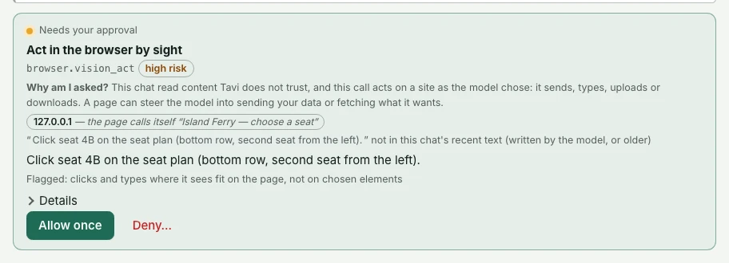
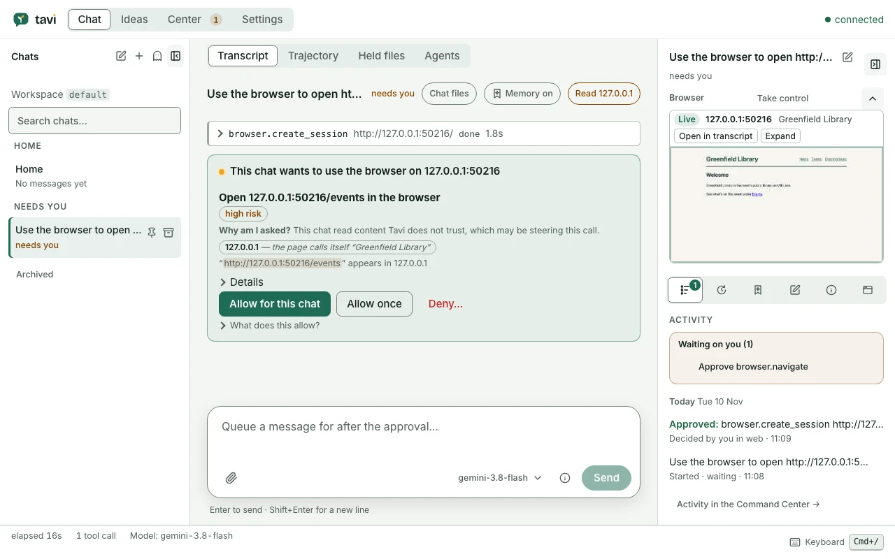
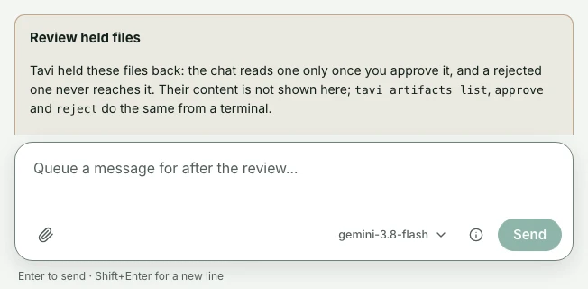
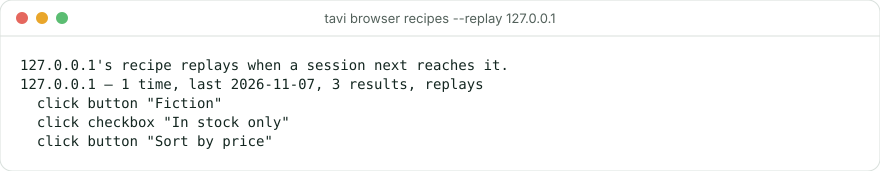
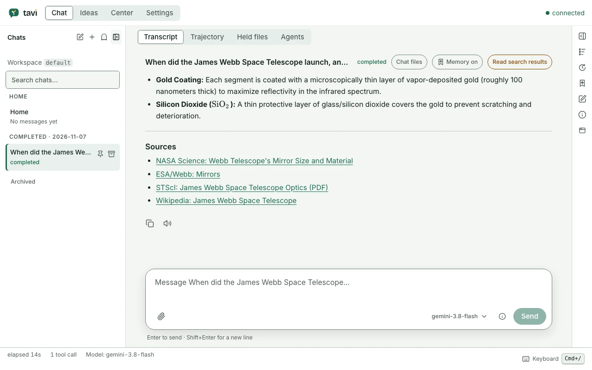
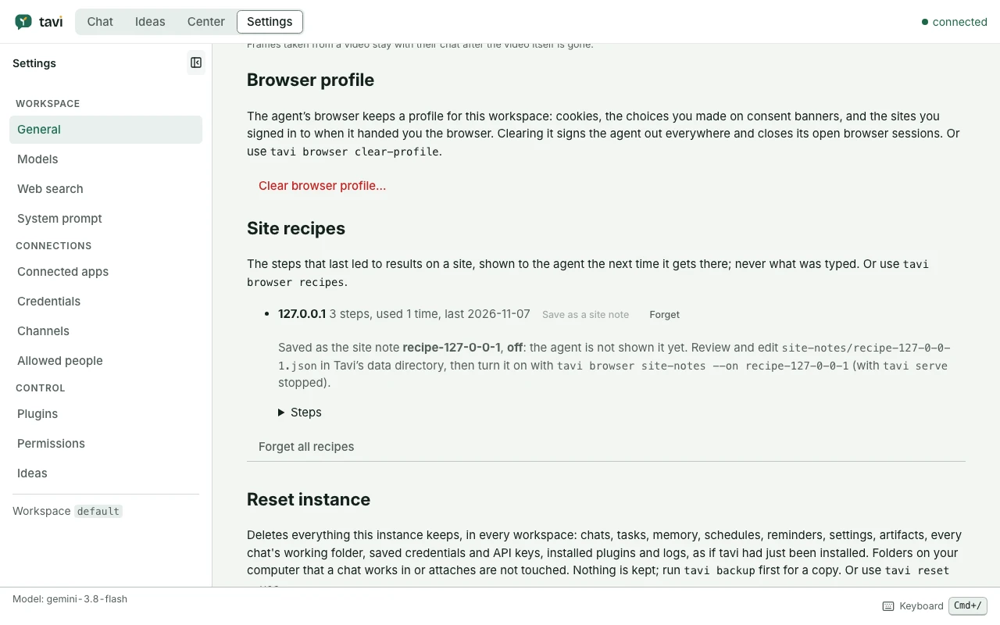
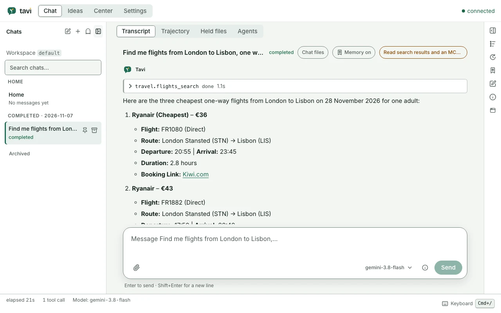
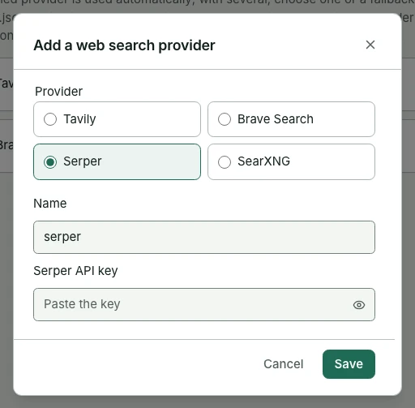
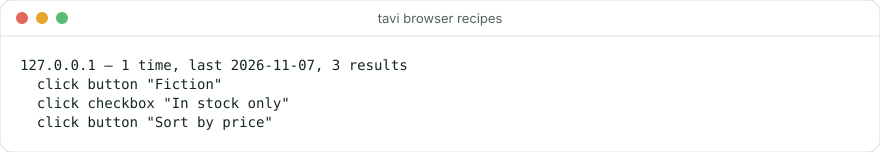
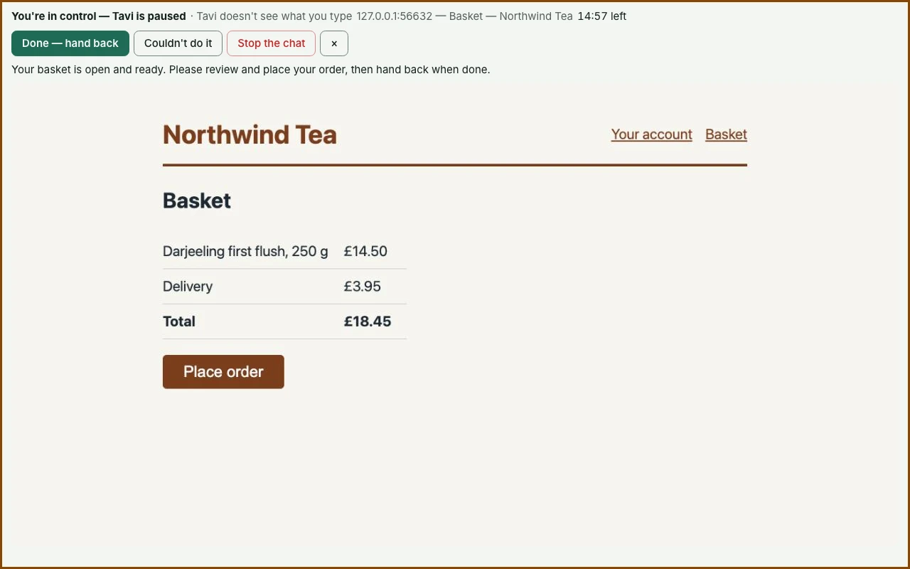

<!-- Generated by scripts/docs/guide-indexes.mjs from the guides: edit the guides, not this file. -->

# Web and browser

Search, research and the agent's own browser.

| | Guide |
| :--- | :--- |
|  | [Let the model act on a page by sight (computer use)](act-by-sight.md) Some controls are only pictures: a seat plan, a map, a date picker drawn its own way. |
|  | [Let Tavi drive a browser while you watch, signed in or signed out](browse-with-tavi.md) Ask Tavi to look something up on a website and follow its browser live in the canvas: it asks before it opens each site, and a task that needs no sign-in runs in a signed-out browser that keeps nothing. |
|  | [Download bills from a portal you sign in to](download-bills.md) Have Tavi fetch your latest bills from a supplier's website: you sign in yourself, Tavi finds the bills, and each file waits for your approval before the chat may use it. |
|  | [Replay a site's recipe step by step](replay-a-site-recipe.md) Mark a site's recipe to replay, and the next time a chat opens that site, Tavi runs the steps that worked before, before the model even sees the page. |
|  | [Research a question with cited sources](research-with-sources.md) Ask a question that needs the web and get an answer with the pages it came from: Tavi searches, reads what it needs, and lists its sources with their links so you can check them. |
|  | [Save what worked on a site as a site note](save-a-site-note.md) Turn the steps that worked on a site into a site note of your own: a short file that says how to use the site, which you can edit, and which the agent reads every time it reaches that site once you turn it on. |
|  | [Compare flights](search-flights.md) Ask Tavi for flights in plain words and get itineraries back: airlines, flight numbers, times, stops and prices, with a link to check each fare. |
|  | [Set up web search](set-up-web-search.md) Give Tavi a search provider so it can look things up on the web: Tavily works without a key to start with, and Brave Search or Serper take a key you store once. |
|  | [Review what Tavi learned about a site, or clear its browser profile](site-recipes-and-profile.md) When Tavi's browser finds results on a site, Tavi keeps the steps that got it there, a recipe, and reads them the next time it reaches that site. |
|  | [Take over for a login or a final checkout](take-over-the-browser.md) Let Tavi do the browsing and step in yourself for the parts that are yours: signing in, and placing an order. |

[All how-to guides](../README.md)
