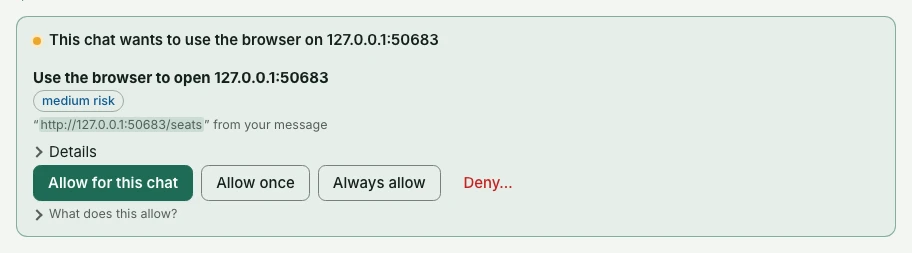
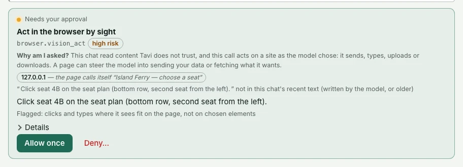
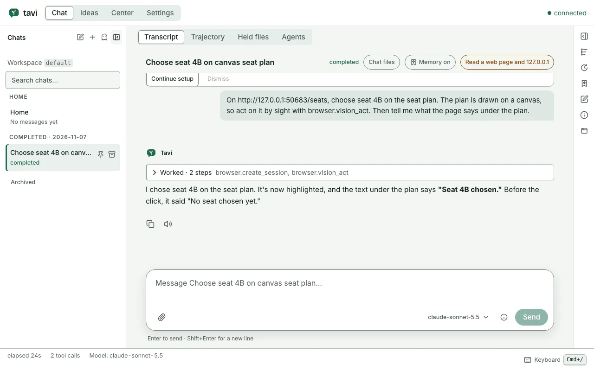
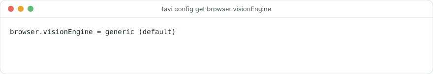

# Let the model act on a page by sight (computer use)

Some controls are only pictures: a seat plan, a map, a date picker drawn its own way. For those, Tavi can hand one step to a model that looks at the page and clicks, types and scrolls on it, one action at a time. Each time it is asked about first. About five minutes.

> **Uses:** acting by sight (`browser.vision_act`) · the agent's browser (`browser.*`) · `browser.visionEngine`
> **Before you start:** a model connected that reads images ([Connect your first model](../get-started/first-model.md)) · Tavi running with `tavi serve` ([Keep Tavi running in the background](../get-started/keep-tavi-running.md)) · the browser installed ([Installing it](../../BROWSER.md#installing-it))

## 1. Ask for something on a drawn control

In a new chat, name the page and what to pick: "On ferry.example.com/seats, choose seat 4B on the seat plan, then tell me what the page says." The first card asks to use the browser on that site; choose **Allow for this chat**.

## 2. Allow acting by sight once

When the page's elements cannot do the step, the agent asks to **Act in the browser by sight**, at high risk, with the instruction it will give the vision model. Read it, then choose **Allow once**: acting by sight is asked about every time, even with the browser allowed for the chat, because it clicks and types where it sees fit rather than on an element the agent named.

<!-- cover -->

## 3. Read what it did

The vision model takes a screenshot, makes one action, and looks again, until the step is done or it runs out of steps (12 by default). The agent then reads the page and answers. How well it lands depends on the model: one built for computer use, such as Claude Sonnet 5.5 (which took these pictures), places its clicks far more surely than a small fast model, which may miss a seat. A step the vision model calls done is checked against the page: when its actions changed nothing there, the result says it is not confirmed, and the agent looks at the page before answering.

## 4. Choose what drives it

Run `tavi config get browser.visionEngine`. `generic`, the default, is Tavi's own loop and works with any model that reads images. `tavi config set browser.visionEngine native` (experimental) hands the step to the model's own computer-use tool on a native Anthropic connection or OpenAI's API; every action it asks for is still run and checked by Tavi's browser.

<picture>
  <source media="(prefers-color-scheme: dark)" srcset="../../assets/use-cases/web-and-browser/act-by-sight/04-choose-what-drives-it-dark.svg">
  
</picture>

## What Tavi will and won't do

The vision model is told never to sign in, pay or confirm a purchase, and each action it takes on a marked control goes through the same checks as the agent's own clicks. A page with a password, card or one-time-code field is never shown to it. Acting by sight uses the first model that reads images among your main model, its fallbacks and the workspace default; with none, it refuses and says so. See [BROWSER.md](../../BROWSER.md#models).

## Related

- [Review what Tavi learned about a site, or clear its browser profile](site-recipes-and-profile.md)
- Reference: [BROWSER.md](../../BROWSER.md#the-tools), [SECURITY-MODEL.md](../../SECURITY-MODEL.md)
