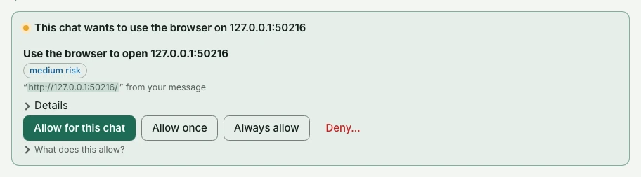
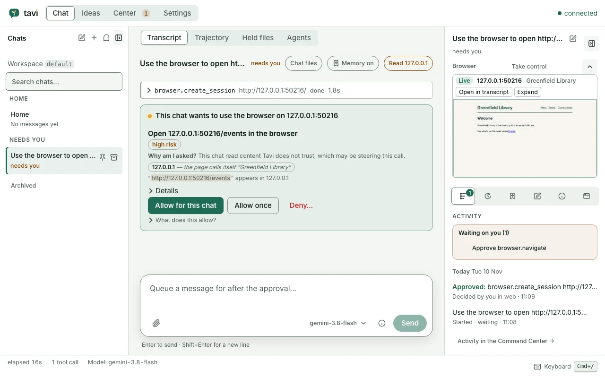
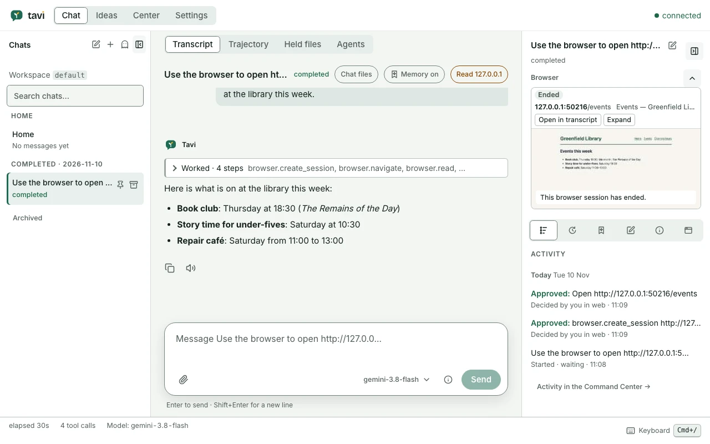
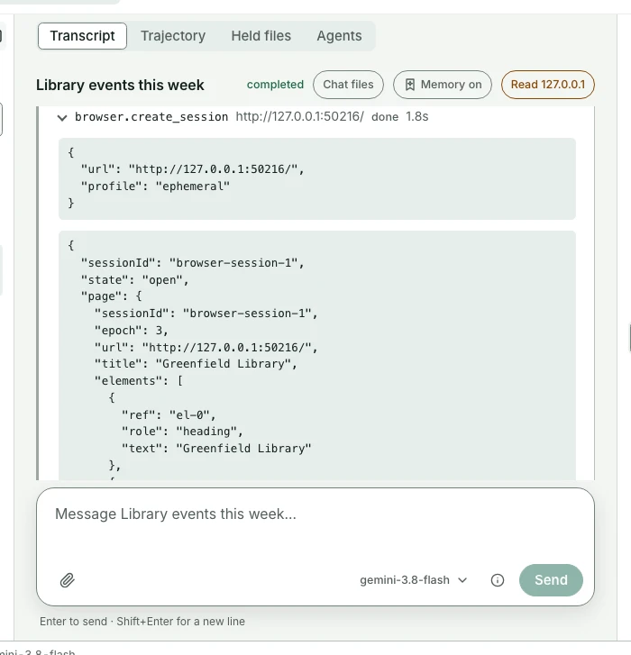
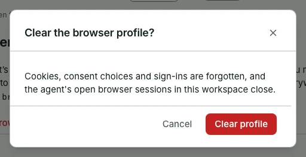

# Let Tavi drive a browser while you watch, signed in or signed out

Ask Tavi to look something up on a website and follow its browser live in the canvas: it asks before it opens each site, and a task that needs no sign-in runs in a signed-out browser that keeps nothing. About five minutes.

> **Uses:** the agent's browser (`browser.create_session`, `browser.act`, `browser.read`) · the live browser view in the chat panel · approvals
> **Before you start:** a model connected ([Connect your first model](../get-started/first-model.md)) · Tavi running in the background with `tavi serve` ([Keep Tavi running in the background](../get-started/keep-tavi-running.md)) · the canvas open ([Open the web canvas and walk through Welcome](../get-started/web-canvas-tour.md)) · for a site on this computer or your own network, its address listed with `tavi serve --browser-allow-host 127.0.0.1:8080`

## 1. Ask Tavi to look something up on a site

Start a new chat with **+** and name the site, for example `Use the browser to open <the site's address> and tell me what's on at the library this week.` Before the browser opens anything, Tavi asks: **This chat wants to use the browser on** the site you named.

## 2. Watch it in the chat panel

Choose **Show this chat's panel** (top right), then **Allow once**. The panel's **Browser** strip shows the page live, marked **Live**, and the next card says what Tavi wants to do on it. With **Allow once**, the next step asks again, so you can follow it one step at a time. **Expand** moves the view to the panel's **Browser** tab.

<!-- cover -->

## 3. Let it carry on

Choose **Allow for this chat**. Tavi may now browse that site for the rest of the chat without asking; another site still asks. It reads the page it needs and answers, and the view shows **Ended** once the task is done.

## 4. Check whether it was signed in

Open the **browser.create_session** call in the transcript. `"profile": "ephemeral"` means a signed-out browser that keeps no cookies and forgets everything when it closes; Tavi chooses it for a task that needs no sign-in. Without it, the browser uses this workspace's profile, where the sites you signed in to stay signed in.

## 5. Forget what the browser kept

Open **Settings → General** and choose **Clear browser profile…**, then **Clear profile**. Cookies, consent choices and sign-ins are forgotten, and the workspace's open browser sessions close. `tavi browser clear-profile` does the same.

## What Tavi will and won't do

The browser opens a site only after you allow it there, one site at a time, and a page Tavi reads never counts as your instructions. Paying, sending, submitting a form, uploading and downloading are each asked about on their own, even on a site you allowed. This computer and your private network are closed to the browser unless you list its address with `tavi serve --browser-allow-host 127.0.0.1:8080`, and a page with a password or card field is never shown in the live view.

## Related

- [Understand a blocked action (untrusted content)](../chat/why-was-this-blocked.md)
- [Approve, reject or always-allow a tool call](../chat/approve-tool-calls.md)
- Reference: [BROWSER.md](../../BROWSER.md)
