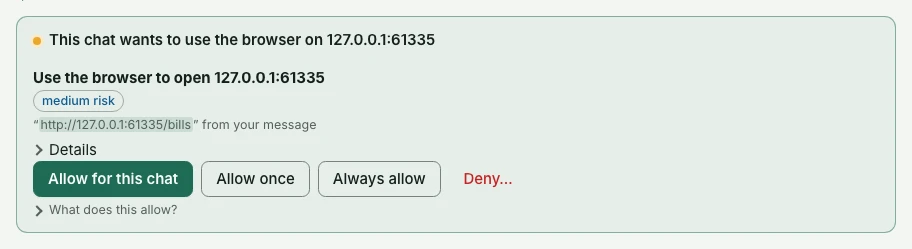
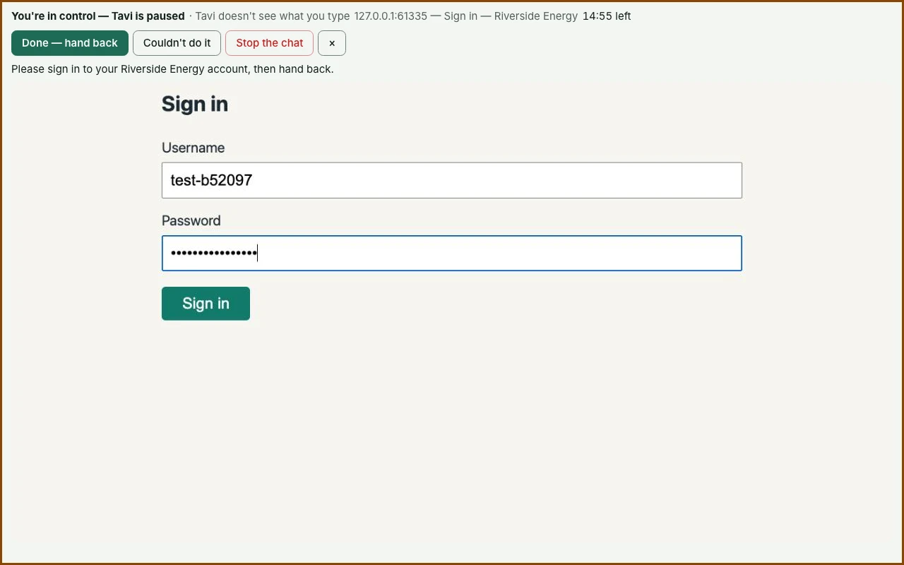
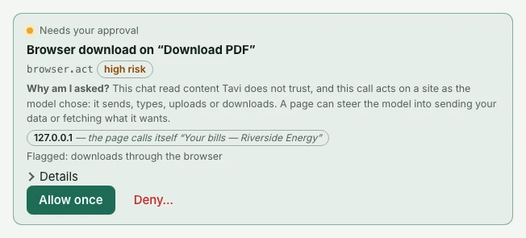
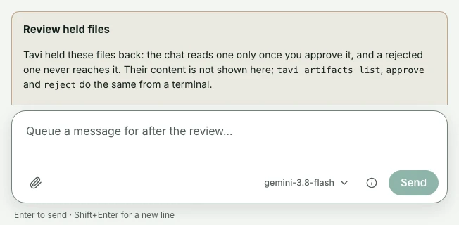
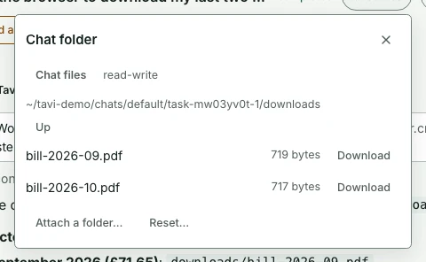

# Download bills from a portal you sign in to

Have Tavi fetch your latest bills from a supplier's website: you sign in yourself, Tavi finds the bills, and each file waits for your approval before the chat may use it. The PDFs end up in the chat's own folder. About ten minutes.

> **Uses:** the agent's browser (`browser.act` downloads, `browser.request_handoff`) · taking over in the canvas · held files you review (`tavi artifacts list`)
> **Before you start:** a model connected ([Connect your first model](../get-started/first-model.md)) · Tavi running in the background with `tavi serve` ([Keep Tavi running in the background](../get-started/keep-tavi-running.md)) · the canvas open on this computer ([Open the web canvas and walk through Welcome](../get-started/web-canvas-tour.md)) · your account on the portal

## 1. Ask for your bills

In a new chat, name the portal and say you will sign in: `Use the browser to download my last two bills (the PDFs) from my energy supplier's portal at <the portal's address>/bills. It needs a sign-in: hand the browser to me and I'll sign in myself.` Tavi asks to use the browser on the portal's site: choose **Allow for this chat**.

## 2. Sign in yourself

When **Tavi needs you in the browser** shows, choose **Take control**, sign in in the page, and choose **Done — hand back**, then **Hand back**. Tavi doesn't see what you type.

## 3. Approve each download

Tavi finds the bills and asks before each download: **Needs your approval**, **Flagged: downloads through the browser**. Choose **Allow once**. A download is never allowed for the whole chat, and a plain click on a download link keeps nothing.

## 4. Review the file before Tavi reads it

Each file is held until you approve it: **Review held files** lists it by its name, with its type and size. Choose **Approve artifact**, and Tavi reads it and goes on to the next bill; **Reject artifact** keeps it out of the chat. `tavi artifacts list` shows the same held files in the terminal.

<!-- cover -->

## 5. Find the bills in Chat files

When both are in, Tavi says what it downloaded. Choose **Chat files** above the chat: the bills are in `downloads/`, kept with the chat.

## What Tavi will and won't do

You do the signing in: Tavi never asks for your password, and the sign-in page is never shown in the live view except to you while you hold it. Every download asks first, and a downloaded file stays out of the chat until you approve it (at most `browser.downloadMaxMiB`, 256 MiB by default). The browser keeps the portal's sign-in in this workspace's profile until you clear it. Details: [BROWSER.md](../../BROWSER.md#acting).

## Related

- [Take over for a login or a final checkout](take-over-the-browser.md)
- [Let Tavi drive a browser while you watch, signed in or signed out](browse-with-tavi.md)
- Reference: [BROWSER.md](../../BROWSER.md), [CLI.md](../../CLI.md)
