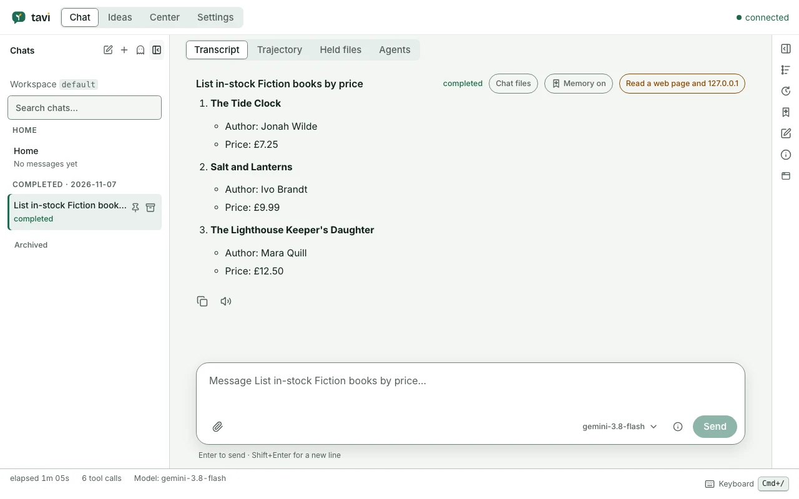
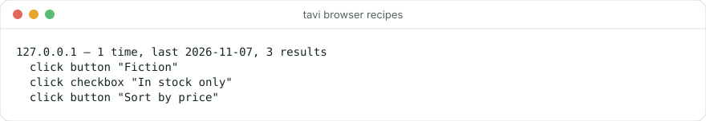
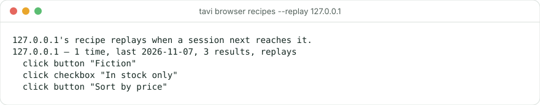
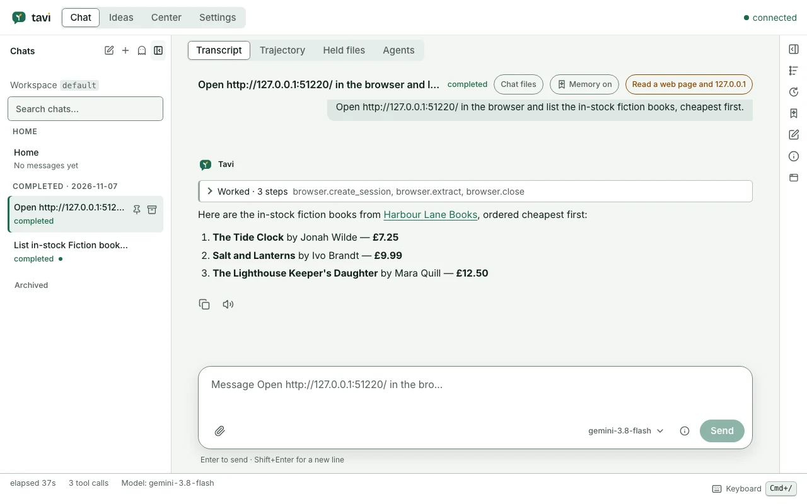
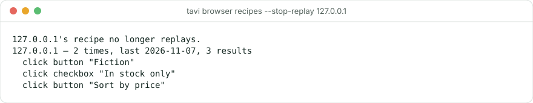

# Replay a site's recipe step by step

Mark a site's recipe to replay, and the next time a chat opens that site, Tavi runs the steps that worked before, before the model even sees the page. Each step is held to the same checks as a click the agent makes itself, and the replay stops at the first one that does not fit. About five minutes.

> **Uses:** the agent's browser (`browser.create_session`, `browser.navigate`) · site recipes (`tavi browser recipes --replay <host>`)
> **Before you start:** a model connected ([Connect your first model](../get-started/first-model.md)) · Tavi running with `tavi serve` ([Keep Tavi running in the background](../get-started/keep-tavi-running.md)) · the browser installed ([Installing it](../../BROWSER.md#installing-it))

## 1. Ask Tavi to find something on a site

In a new chat, ask for something a site lists, and name the site: "Open books.example.com, show the Fiction shelf, tick In stock only, sort by price and list the books." Choose **Allow for this chat** when the card asks to use the browser there. The steps that led to the books become the site's recipe.

## 2. Check the recipe

Run `tavi browser recipes` and read the site's steps. A replay runs clicks, choices and keys; a step that typed something stops it, because what was typed is never kept, and so does a step that would submit, pay, book or send.

<picture>
  <source media="(prefers-color-scheme: dark)" srcset="../../assets/use-cases/web-and-browser/replay-a-site-recipe/02-check-the-recipe-dark.svg">
  
</picture>

## 3. Mark it to replay

Run `tavi browser recipes --replay <host>`. The site's recipe is now listed with **replays**.

<!-- cover -->
<picture>
  <source media="(prefers-color-scheme: dark)" srcset="../../assets/use-cases/web-and-browser/replay-a-site-recipe/03-mark-it-to-replay-dark.svg">
  
</picture>

## 4. Ask again in a new chat

Start a chat that has read nothing yet and ask about the same site. A chat opened from the first one carries what that one read from the bookshop, so open the first chat, choose its **Read a web page** chip, then **Start a fresh chat**. When the browser opens the site, the recipe's steps run first, and the agent is told how many ran and why the replay stopped, if it did: here the shelf, the filter and the sort are already set when it first reads the page. A replay runs only in a chat you are in, and only while that chat has read nothing from the web or a document.

## 5. Stop replaying it

Run `tavi browser recipes --stop-replay <host>`. The recipe stays, as a hint the agent reads, and nothing runs by itself.

<picture>
  <source media="(prefers-color-scheme: dark)" srcset="../../assets/use-cases/web-and-browser/replay-a-site-recipe/05-stop-replaying-it-dark.svg">
  
</picture>

## What Tavi will and won't do

A recipe replays only when you mark it, only when the browser opens the site itself (not after a click), and never in a run nobody attends, such as a schedule's, or in a chat that has read untrusted content. Every replayed step passes the checks a click of the agent's own does: it stops before a submit, an upload or a download, before a control that pays, books, orders or sends, and at the first control it cannot find on the page as the recipe names it. See [Site notes, site profiles and recipes](../../BROWSER.md#site-notes-site-profiles-and-recipes).

## Related

- [Review what Tavi learned about a site, or clear its browser profile](site-recipes-and-profile.md)
- [Save what worked on a site as a site note](save-a-site-note.md)
- Reference: [`tavi browser recipes`](../../CLI.md#tavi-browser-recipes), [BROWSER.md](../../BROWSER.md)
