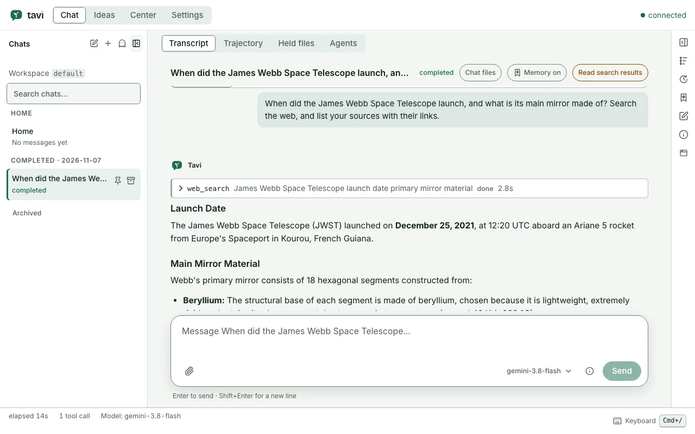
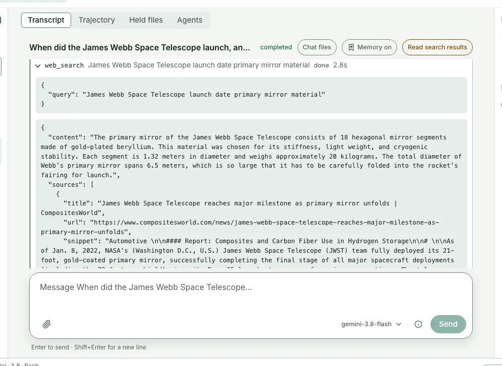
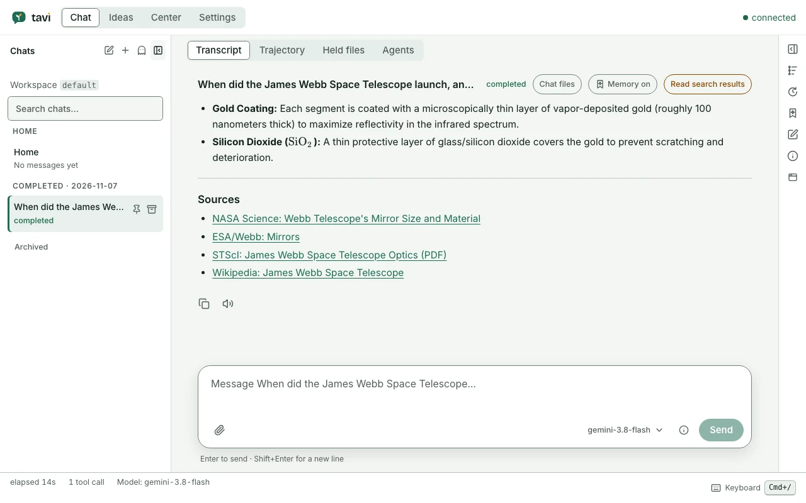
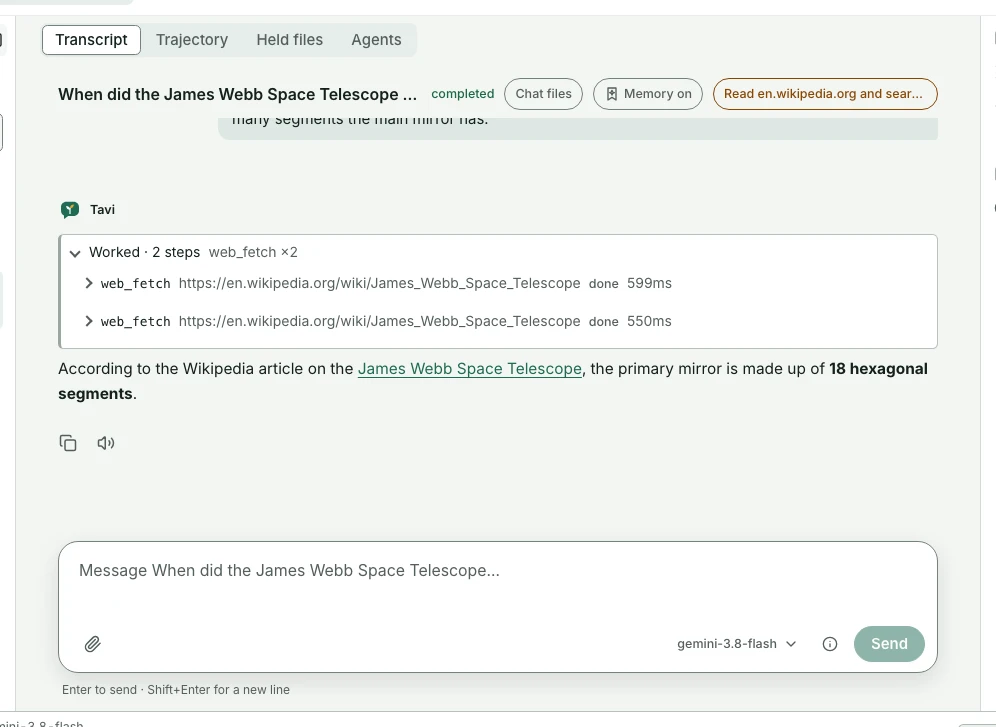
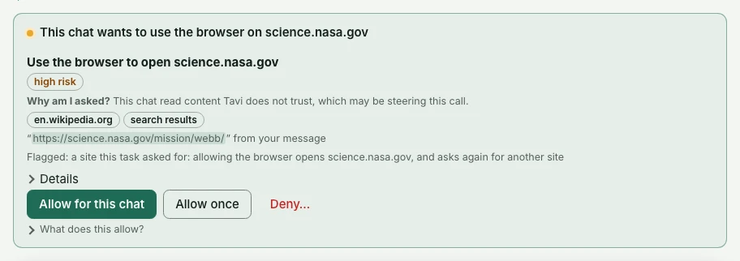

# Research a question with cited sources

Ask a question that needs the web and get an answer with the pages it came from: Tavi searches, reads what it needs, and lists its sources with their links so you can check them. About five minutes.

> **Uses:** web search (`web_search`) · reading a page (`web_fetch`) · the agent's browser for other sites (`browser.create_session`)
> **Before you start:** a model connected ([Connect your first model](../get-started/first-model.md)) · web search set up ([Set up web search](set-up-web-search.md)) · Tavi running in the background with `tavi serve` ([Keep Tavi running in the background](../get-started/keep-tavi-running.md)); to let it read a site's pages without asking, start it with that site listed: `tavi serve --http-allow-host en.wikipedia.org`

## 1. Ask your question

Start a new chat with **+** and ask, saying you want sources: `When did the James Webb Space Telescope launch, and what is its main mirror made of? Search the web, and list your sources with their links.` Tavi searches without asking you first, then answers.

## 2. See what it searched for

Open the **web_search** call in the transcript. It shows the words Tavi searched for, which provider answered, and every result it got back, each with its title and link.

## 3. Check the sources

The answer ends with its sources, as links. Open one to check a claim against the page itself. The **Read …** label beside the chat's title says the chat has read web content, which Tavi treats as information, never as instructions.

<!-- cover -->

## 4. Have it read a page in full

Ask for a detail a search snippet won't have: `Read the Wikipedia article on the James Webb Space Telescope with web_fetch, and tell me how many segments the main mirror has.` On a site the owner allows with `--http-allow-host`, **web_fetch** reads the page without asking, as long as its address came from you or from a result Tavi found.

## 5. Decide about other sites

For a site not on that list, Tavi asks to open it in the browser: **This chat wants to use the browser on** that site. Choose **Allow for this chat** to let it read there, or **Deny…** and Tavi answers from what it already has.

## What Tavi will and won't do

Searching doesn't ask first, unless the query looks like it carries a key or a token, or the chat has read an untrusted page and also holds private data; a page Tavi opened in the browser counts as both. Pages and results are kept apart from your instructions: once the chat has read the web, a call that could send your data out or open an address no one gave it asks you, and offers only **Allow once**. Tavi doesn't vouch for a source; the links are there so you can check. More in [SECURITY-MODEL.md](../../SECURITY-MODEL.md).

## Related

- [Set up web search](set-up-web-search.md)
- [Let Tavi drive a browser while you watch, signed in or signed out](browse-with-tavi.md)
- Reference: [TOOLS-AND-SKILLS.md](../../TOOLS-AND-SKILLS.md), [CLI.md](../../CLI.md#tavi-search)
