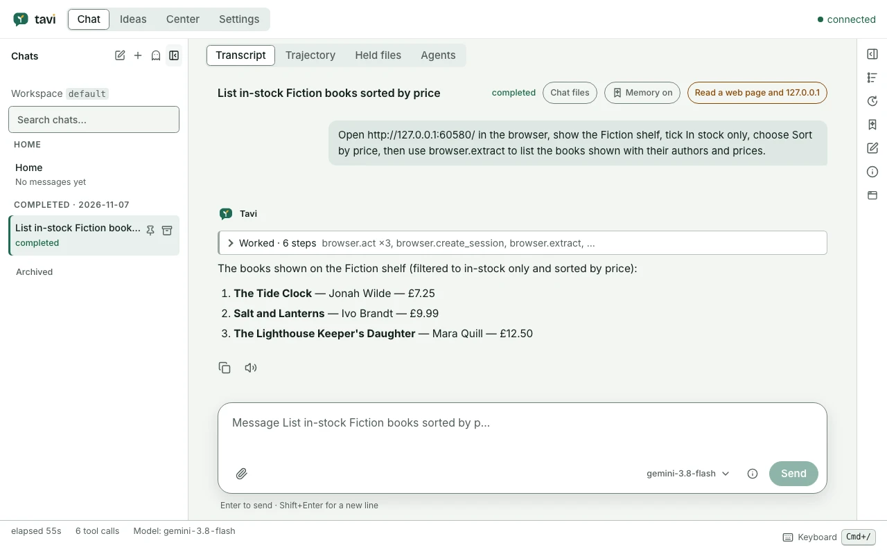
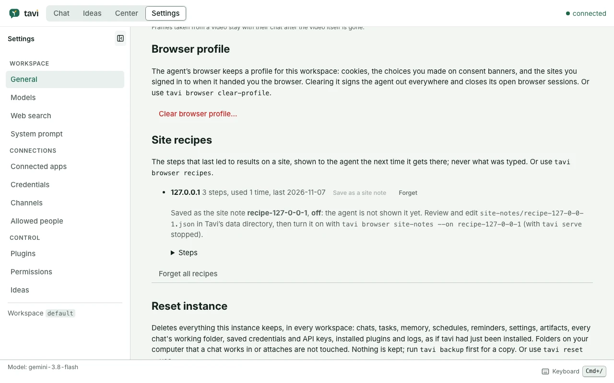
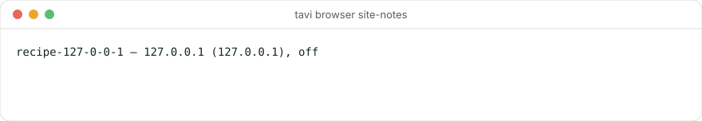
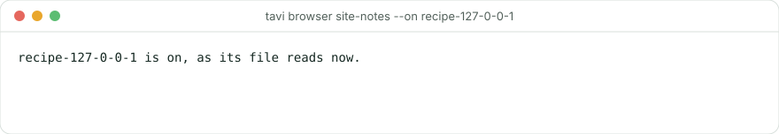
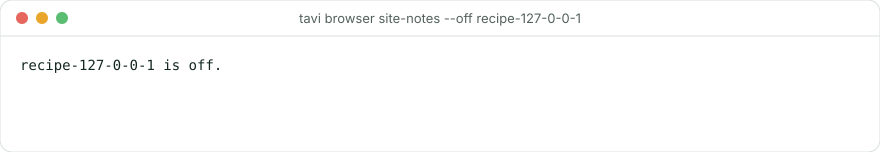

# Save what worked on a site as a site note

Turn the steps that worked on a site into a site note of your own: a short file that says how to use the site, which you can edit, and which the agent reads every time it reaches that site once you turn it on. About five minutes.

> **Uses:** site recipes (Settings → General) · site notes (`tavi browser site-notes`)
> **Before you start:** a model connected ([Connect your first model](../get-started/first-model.md)) · Tavi running with `tavi serve` ([Keep Tavi running in the background](../get-started/keep-tavi-running.md)) · the browser installed ([Installing it](../../BROWSER.md#installing-it))

## 1. Ask Tavi to find something on a site

In a new chat, ask for something a site lists, and name the site: "Open books.example.com, show the Fiction shelf, tick In stock only, sort by price and list the books." Choose **Allow for this chat** when the card asks to use the browser there. The steps that led to the books become the site's recipe.

## 2. Save the recipe as a site note

Open **Settings → General**, find the site under **Site recipes** and choose **Save as a site note**. Tavi writes the note to `site-notes/` in its data directory, off, and says so with the command that turns it on. `tavi browser site-notes --propose <host>` does the same from the terminal; neither writes over a note that is already there.

<!-- cover -->

## 3. Stop Tavi and list your notes

Notes are turned on and off in Tavi's data directory, so stop `tavi serve` first. Then run `tavi browser site-notes`: each note with its hosts, and whether it is on. Open the note's file to read and edit it before you turn it on: its `notes` are the sentences the agent will read, and you can add a `searchUrl` that opens a search on the site directly.

<picture>
  <source media="(prefers-color-scheme: dark)" srcset="../../assets/use-cases/web-and-browser/save-a-site-note/03-stop-tavi-and-list-your-notes-dark.svg">
  
</picture>

## 4. Turn the note on

Run `tavi browser site-notes --on <id>`, then start `tavi serve` again. The note is on as its file reads now: change the file later and it is off again until you turn it on once more.

<picture>
  <source media="(prefers-color-scheme: dark)" srcset="../../assets/use-cases/web-and-browser/save-a-site-note/04-turn-the-note-on-dark.svg">
  
</picture>

## 5. Turn it off when you no longer want it

With `tavi serve` stopped, run `tavi browser site-notes --off <id>`. The file stays in `site-notes/` for you to edit or delete.

<picture>
  <source media="(prefers-color-scheme: dark)" srcset="../../assets/use-cases/web-and-browser/save-a-site-note/05-turn-it-off-when-you-no-longer-want-it-dark.svg">
  
</picture>

## What Tavi will and won't do

A site note reaches the agent as reference notes on the site, never as instructions: the page and your request decide where they differ. A note is off until you turn it on, and off again as soon as its file changes, so nothing you did not review is read. A note you turned on is read before Tavi's built-in notes for the same site. See [Site notes, site profiles and recipes](../../BROWSER.md#site-notes-site-profiles-and-recipes).

## Related

- [Review what Tavi learned about a site, or clear its browser profile](site-recipes-and-profile.md)
- [Replay a site's recipe step by step](replay-a-site-recipe.md)
- Reference: [`tavi browser site-notes`](../../CLI.md#tavi-browser-site-notes), [BROWSER.md](../../BROWSER.md)
