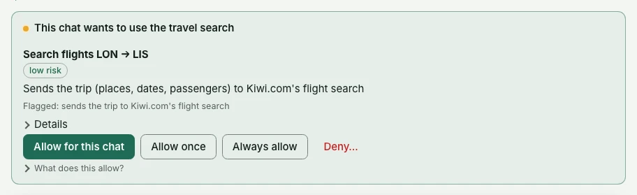
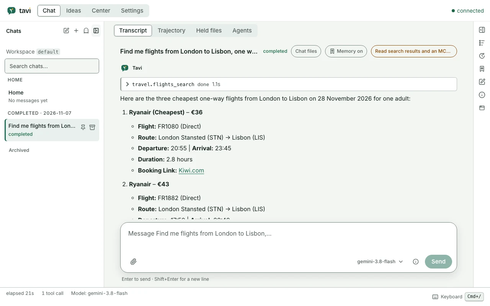
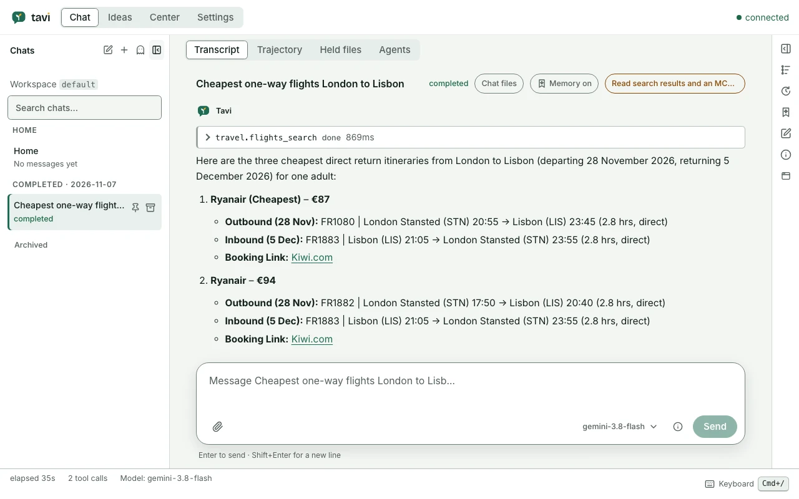
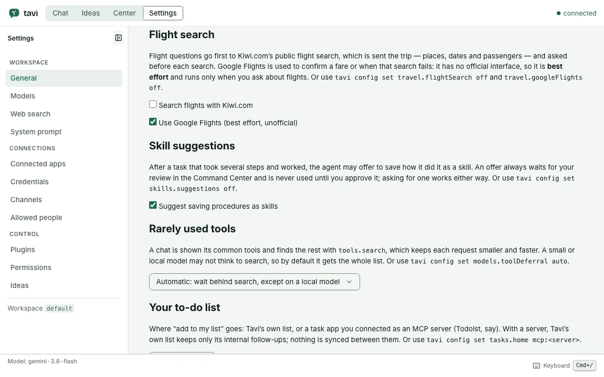

# Compare flights

Ask Tavi for flights in plain words and get itineraries back: airlines, flight numbers, times, stops and prices, with a link to check each fare. Tavi asks Kiwi.com's free flight search first, so there is no key to set up. About three minutes.

> **Uses:** flight search (`travel.flights_search`) · Settings → General → **Flight search**
> **Before you start:** a model connected ([Connect your first model](../get-started/first-model.md)) · the web canvas open ([Open the web canvas and walk through Welcome](../get-started/web-canvas-tour.md))

## 1. Ask for flights

In a new chat, say where from, where to, the day and who is flying: "Find me flights from London to Lisbon, one way, on 22 November, for one adult. Show me the three cheapest." A card asks before the search runs: **This chat wants to use the travel search**, flagged as sending the trip to Kiwi.com's flight search.

## 2. Allow the search

Choose **Allow for this chat**, so a follow-up search in this chat does not ask again. Only the trip is sent: the places, the dates, the number of travellers, the cabin and the currency, nothing about you.

<!-- cover -->

## 3. Narrow it down

Ask a follow-up in the same chat, such as "Only direct flights, and add a return a week later." Tavi searches again with the new trip and answers from what it found. The answer also links a Google Flights and a Kayak search for the same trip, to check a fare before you book it yourself.

## 4. Turn flight search off or on

Open **Settings → General → Flight search**. Turn off **Search flights with Kiwi.com** and Tavi browses flight sites itself instead; turn off **Use Google Flights (best effort, unofficial)** to leave out the Google Flights links. `tavi config set travel.flightSearch off` does the same as the first.

## What Tavi will and won't do

The flight search only finds flights: booking is yours, on the airline's or the travel agent's own site. Each search is asked about first, unless you allowed it for the chat, and sends only the trip. A longest flight time you ask for is held to in code, the flights found are Kiwi.com's, and the Google Flights links are best effort. See [BROWSER.md](../../BROWSER.md#how-the-model-is-told-to-browse).

## Related

- [Review what Tavi learned about a site, or clear its browser profile](site-recipes-and-profile.md)
- Reference: [BROWSER.md](../../BROWSER.md#how-the-model-is-told-to-browse), [CONFIGURATION.md](../../CONFIGURATION.md)
