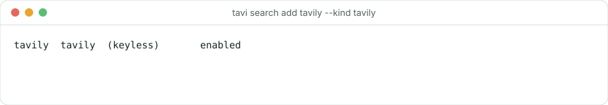
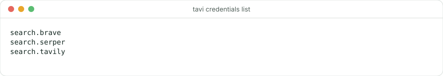
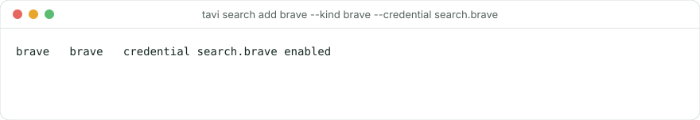
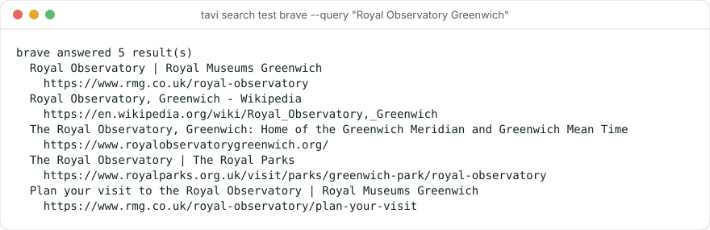
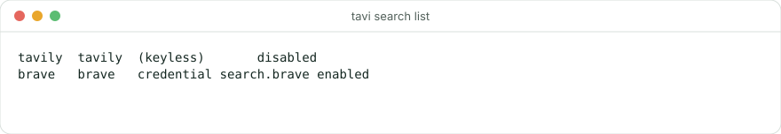
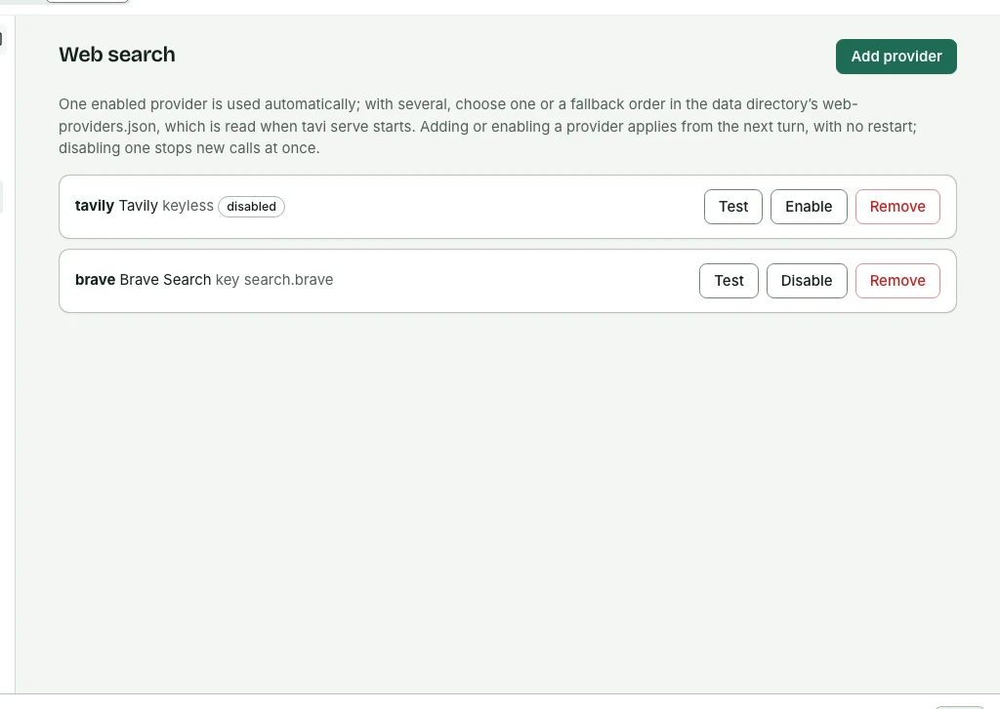
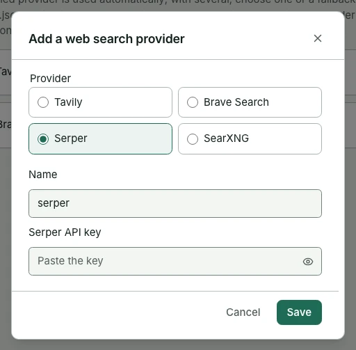

# Set up web search

Give Tavi a search provider so it can look things up on the web: Tavily works without a key to start with, and Brave Search or Serper take a key you store once. About five minutes.

> **Uses:** web search (`web_search`, `tavi search list`) · the credentials file (`tavi credentials list`) · the canvas's **Settings → Web search**
> **Before you start:** Tavi running in the background with `tavi serve` ([Keep Tavi running in the background](../get-started/keep-tavi-running.md)) · for Brave Search or Serper, an API key from that provider

## 1. Start with Tavily, no key needed

Run `tavi search add tavily --kind tavily`. With no `--credential`, Tavily runs in its keyless mode, which is enough to try web search but is rate-limited.

<picture>
  <source media="(prefers-color-scheme: dark)" srcset="../../assets/use-cases/web-and-browser/set-up-web-search/01-start-with-tavily-no-key-needed-dark.svg">
  
</picture>

## 2. Store a key for another provider

For regular use, give Tavi a key. Save it in a file only you can read (`chmod 600`), then run `tavi credentials set search.brave --file brave-key.txt`. Tavi never prints a key back: `tavi credentials list` shows only the names it stores.

<picture>
  <source media="(prefers-color-scheme: dark)" srcset="../../assets/use-cases/web-and-browser/set-up-web-search/02-store-a-key-for-another-provider-dark.svg">
  
</picture>

## 3. Add the provider with its key

Run `tavi search add brave --kind brave --credential search.brave`. Serper is the same with `--kind serper`. The list shows which key each provider uses, by name.

<picture>
  <source media="(prefers-color-scheme: dark)" srcset="../../assets/use-cases/web-and-browser/set-up-web-search/03-add-the-provider-with-its-key-dark.svg">
  
</picture>

## 4. Test it

Run `tavi search test brave --query "Royal Observatory Greenwich"`. Tavi runs one search through the provider, as `web_search` would, and prints what came back, or why it was refused.

<picture>
  <source media="(prefers-color-scheme: dark)" srcset="../../assets/use-cases/web-and-browser/set-up-web-search/04-test-it-dark.svg">
  
</picture>

## 5. Keep one provider on

With one provider enabled, Tavi uses it without asking which. Turn the keyless one off with `tavi search disable tavily`, and check with `tavi search list`. To use several in a fixed order instead, name them in `web-providers.json` in the data directory.

<picture>
  <source media="(prefers-color-scheme: dark)" srcset="../../assets/use-cases/web-and-browser/set-up-web-search/05-keep-one-provider-on-dark.svg">
  
</picture>

## 6. Check them in the canvas

Open **Settings → Web search**. It lists the same providers, each with the key it uses by name, and **Test**, **Enable** or **Disable**, and **Remove**.

## 7. Or add one in the canvas

Choose **Add provider**, pick the provider, give it a **Name**, paste its key and choose **Save**. The canvas stores the key in the same credentials file, as `search.<name>`.

<!-- cover -->

## What Tavi will and won't do

`web_search` runs without asking, by a rule every new data directory starts with (`tavi permissions rm seeded-web-search` to be asked each time); a search that looks like it carries a key or a token asks first, and so does one in a chat that has read an untrusted page and holds private data, which a page Tavi opened in the browser counts as. A schedule that runs while you are away searches only when it was given `--allow web_search`. Keys stay in Tavi's credentials file: no command prints them, and the model never sees them.

## Related

- [Understand a blocked action (untrusted content)](../chat/why-was-this-blocked.md)
- [Open the web canvas and walk through Welcome](../get-started/web-canvas-tour.md)
- Reference: [CLI.md](../../CLI.md#tavi-search), [PLUGINS.md](../../PLUGINS.md#web-provider-selection-and-receipts)
