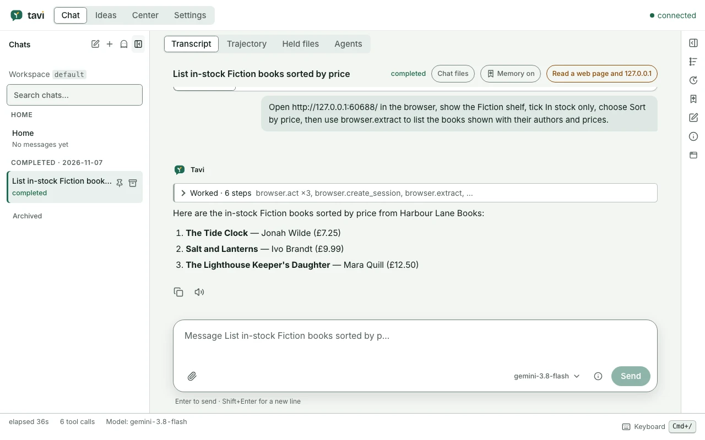
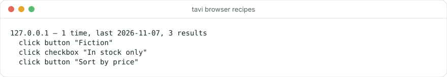
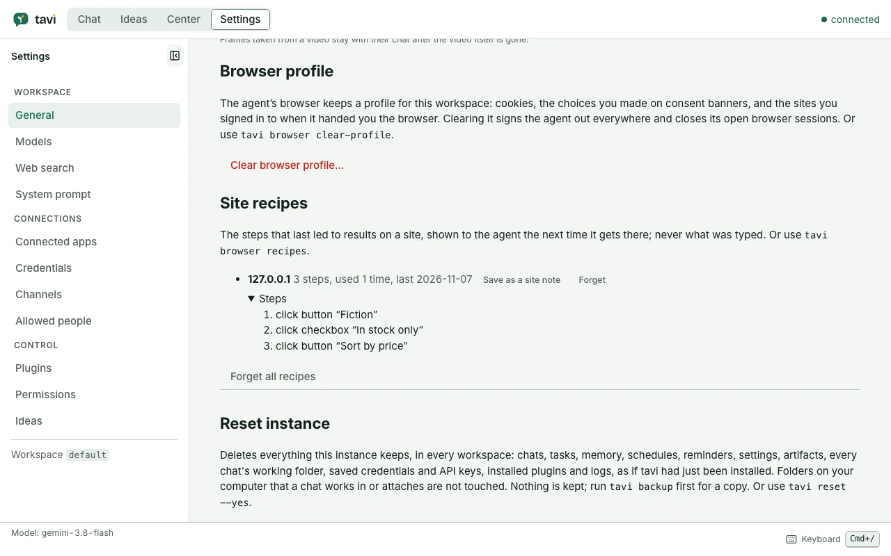
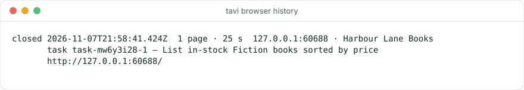
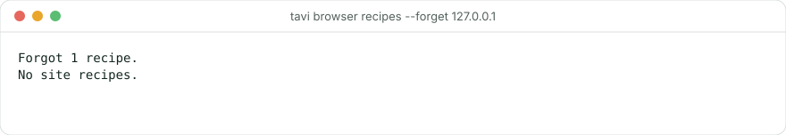
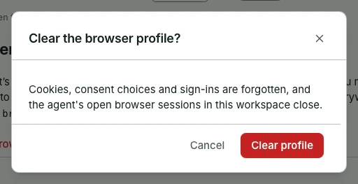

# Review what Tavi learned about a site, or clear its browser profile

When Tavi's browser finds results on a site, Tavi keeps the steps that got it there, a recipe, and reads them the next time it reaches that site. See those recipes, forget one that no longer fits, check which sites the browser opened, and clear the cookies and sign-ins it keeps. About five minutes.

> **Uses:** the agent's browser (`browser.*`) · site recipes (`tavi browser recipes`) · browser history (`tavi browser history`) · the browser profile (`tavi browser clear-profile`)
> **Before you start:** a model connected ([Connect your first model](../get-started/first-model.md)) · Tavi running with `tavi serve` ([Keep Tavi running in the background](../get-started/keep-tavi-running.md)) · the browser installed ([Installing it](../../BROWSER.md#installing-it))

## 1. Ask Tavi to find something on a site

In a new chat, ask for something a site lists, and name the site: "Open books.example.com, show the Fiction shelf, tick In stock only, sort by price and list the books." When the card asks to use the browser on that site, choose **Allow for this chat**.

## 2. See the recipe it kept

Run `tavi browser recipes`. Each site lists the steps that last led to results, each named by its control's role and label, how many times they worked and how many results they found. What you typed is never kept.

<!-- cover -->
<picture>
  <source media="(prefers-color-scheme: dark)" srcset="../../assets/use-cases/web-and-browser/site-recipes-and-profile/02-see-the-recipe-it-kept-dark.svg">
  
</picture>

## 3. Read the steps in Settings

Open **Settings → General** and scroll to **Site recipes**. Each site shows how many steps it has and when they last worked, with **Save as a site note** and **Forget**; open **Steps** to read them.

## 4. Check where the browser went

Run `tavi browser history`. It lists the browser sessions of the last 30 days, newest first: the site and its page title, how many pages and for how long, and the chat that opened it. An address is kept without its query string, so what you searched for stays in the chat.

<picture>
  <source media="(prefers-color-scheme: dark)" srcset="../../assets/use-cases/web-and-browser/site-recipes-and-profile/04-check-where-the-browser-went-dark.svg">
  
</picture>

## 5. Forget a recipe

When a site has changed and its steps no longer fit, run `tavi browser recipes --forget <host>`, or choose **Forget** beside it in Settings. `tavi browser recipes --forget-all` forgets every site's.

<picture>
  <source media="(prefers-color-scheme: dark)" srcset="../../assets/use-cases/web-and-browser/site-recipes-and-profile/05-forget-a-recipe-dark.svg">
  
</picture>

## 6. Clear the browser profile

The browser keeps cookies, the choices you made on consent banners, and the sites you signed in to when it handed you the page. To sign it out everywhere, choose **Clear browser profile…** in **Settings → General**, then **Clear profile**; `tavi browser clear-profile` does the same. Its open sessions close first.

## What Tavi will and won't do

A recipe is only a hint the agent reads: nothing is replayed by itself unless you mark it ([Replay a site's recipe step by step](replay-a-site-recipe.md)), and it never holds what was typed, or a label with an email address, a phone number or a run of digits. Clearing the profile forgets sign-ins, not recipes or history; history is kept 30 days. The browser asks before it opens each new site, and a page's words reach the model as data, never as instructions ([SECURITY-MODEL.md](../../SECURITY-MODEL.md)).

## Related

- [Save what worked on a site as a site note](save-a-site-note.md)
- [Replay a site's recipe step by step](replay-a-site-recipe.md)
- Reference: [Site notes, site profiles and recipes](../../BROWSER.md#site-notes-site-profiles-and-recipes), [`tavi browser recipes`](../../CLI.md#tavi-browser-recipes)
