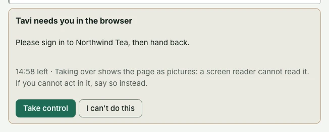
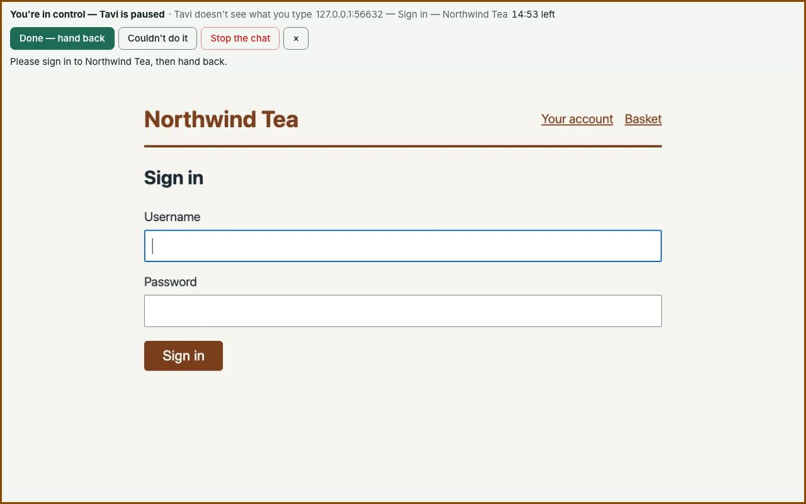
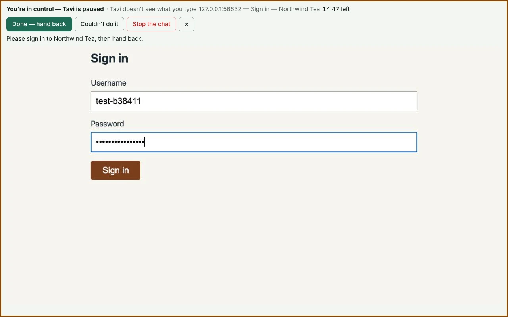
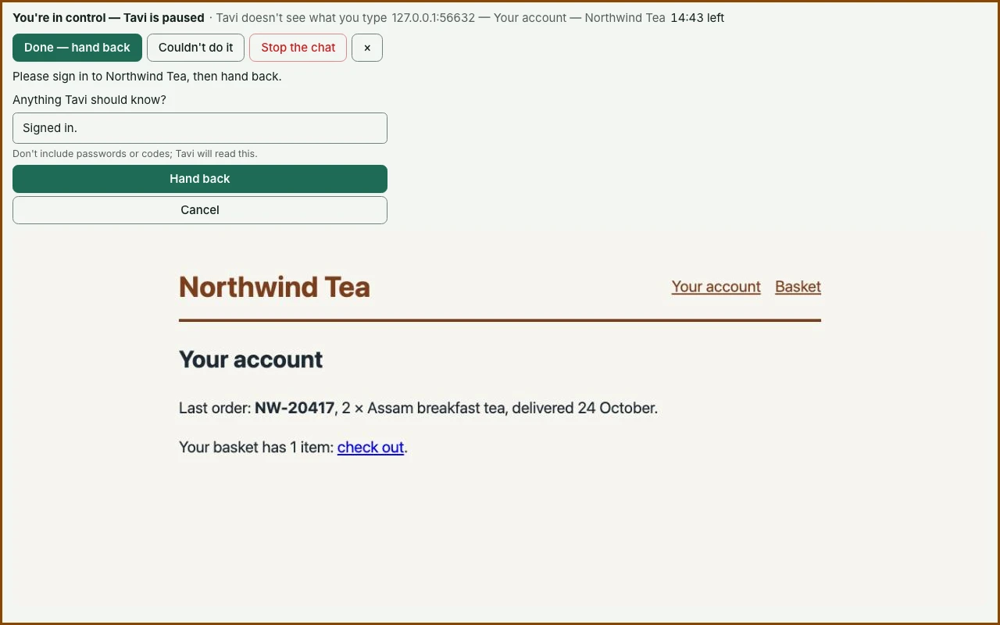
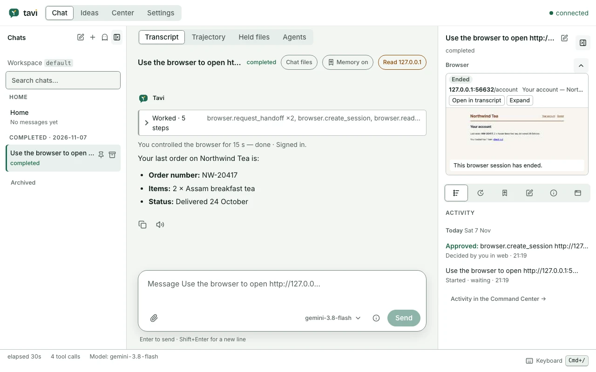
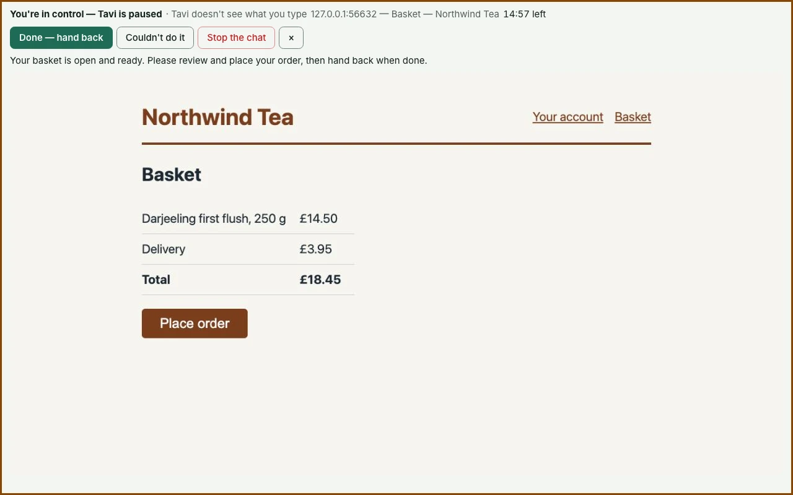

# Take over for a login or a final checkout

Let Tavi do the browsing and step in yourself for the parts that are yours: signing in, and placing an order. You type into the page in the canvas; Tavi waits, doesn't see what you type, and carries on once you hand the browser back. About ten minutes.

> **Uses:** the agent's browser (`browser.request_handoff`) · taking over in the canvas (**Take control**, **Done — hand back**) · the live browser view
> **Before you start:** a model connected ([Connect your first model](../get-started/first-model.md)) · Tavi running in the background with `tavi serve` ([Keep Tavi running in the background](../get-started/keep-tavi-running.md)) · the canvas open on this computer ([Open the web canvas and walk through Welcome](../get-started/web-canvas-tour.md)) · an account on the site

## 1. Ask for something behind a sign-in

In a new chat, ask for something only your account shows, and say you will sign in yourself: `Use the browser to open <the shop's address>/account and tell me my last order. The site needs a sign-in: hand the browser to me and I'll sign in myself.` Allow the browser on that site. When it reaches the sign-in page, Tavi stops and asks: **Tavi needs you in the browser**, with how long it will wait.

## 2. Take control

Choose **Take control**. The page fills the window under Tavi's own bar: **You're in control — Tavi is paused**, the site's address, the time left, **Done — hand back** and **Couldn't do it**.

## 3. Sign in yourself

Click into the page and sign in as you would in your own browser: type, Tab between fields, press Enter. What you type goes to the page only: Tavi never logs it, keeps it or shows it to the model.

## 4. Hand the browser back

Choose **Done — hand back**. You can leave Tavi a short note, never a password or a code, then choose **Hand back**. If it didn't work out, **Couldn't do it** tells Tavi that instead.

## 5. See what Tavi found

The chat says how long you held the browser and your note, and Tavi looks at the page again and carries on from where you left it, signed in.

## 6. Place the order yourself

For a purchase, let Tavi fill the basket and keep the last step: `Open my basket and get it ready, but don't place the order: hand me the browser and I'll place it myself.` Take control, check the total, choose **Place order** in the page, then **Done — hand back**. **Take control** on the live view takes the page whenever you want it, asked or not.

<!-- cover -->

## What Tavi will and won't do

Tavi never asks you for a password or a code, and the note you hand back with is the only thing of yours it reads. A page with a password, card or one-time-code field is never shown in the live view, except to you while you hold it. Even on a site you allowed, a click that pays, buys, books or sends asks first, so the last step stays yours unless you allow it; a request waits up to 15 minutes, and Tavi takes the page back if you leave it idle. Details: [BROWSER.md](../../BROWSER.md#handing-the-browser-to-you).

## Related

- [Let Tavi drive a browser while you watch, signed in or signed out](browse-with-tavi.md)
- [Download bills from a portal you sign in to](download-bills.md)
- Reference: [BROWSER.md](../../BROWSER.md#taking-control), [SECURITY-MODEL.md](../../SECURITY-MODEL.md)
